The coordinator protocol
========================

This page specifies how the members of a ``proto_db`` cluster agree on one order of commits without letting the
storage arbitrate between them. It is written for two readers: a student who wants to follow the reasoning, and
an implementer (protoBaseST, for example) who must reproduce the behaviour without reading the Python code.

Some conventions apply throughout:

* **The code is the authority.** Every rule below is stated as ``proto_db/cluster/`` and
  ``proto_db/transactions.py`` implement it at the commit of this page. Each rule cites the decision (``D``,
  in ``docs/decisions.md``) or the ruling (``R``, in the project's decision ledger) it comes from. Code names
  are given where an implementer needs them.
* **Timing never decides safety (principle P5, ruling R82).** Every timer on this page drives liveness only:
  suspecting an owner, renewing, retrying, giving up. A timer that fires can only cause a conservative failure:
  a timeout, an abandoned term, a refused or retried commit, or an unknown outcome. The safety arguments hold
  under arbitrary delay, loss, duplication and reordering of messages, arbitrary process pauses and timers that
  run at different rates. Every timer is listed, with that statement, in `Timers`_.
* **Vocabulary.** The terms (*voter*, *learner*, *term*, *ballot*, *label*, *phase-1 value*, *witness*,
  *permission*, *gate* and the others) are defined in the :doc:`design-guide/glossary`. The design guide tells
  the history of the main choices: :doc:`design-guide/coordinator`, :doc:`design-guide/pipelined-permits`
  and :doc:`design-guide/unknown-outcomes`.
* **What this page does not repeat.** The byte layouts of messages, the acceptor log and the root records are
  in :doc:`format-spec` ("Cluster wire protocol", "The acceptor log"). Snapshot isolation, read sets and merges
  are in :doc:`concurrency-model`. Local durability, durability modes and recovery on open are in
  :doc:`durability`. A runnable three-node example is :doc:`tutorials/cluster`.

.. contents:: On this page
   :local:
   :depth: 1

The problem in one paragraph
----------------------------

Several processes, each with ``proto_db`` embedded, write one database. A commit builds a new root (an immutable
tree that shares structure with the previous root, P1) on top of the root it read, after validating the read set
(D34) and merging the intents (D33). Two processes must never both publish a root built on the same predecessor,
and a commit acknowledged to its caller must never disappear from the history. The first design (D5) made the
object store's conditional write the arbiter; the maintainer reverted it (D44): contention is resolved among the
processes (P4), with established techniques (P6): Paxos ballots and promises for the lease, a majority of voters
durably accepting each root as the commit point, and Raft's log matching applied to roots within a term.

Diagrams
--------

Every diagram on this page is a Mermaid source kept next to the page, in
``docs/source/coordinator-protocol/*.mmd``, and the page shows the SVG rendered from it. To change a diagram,
edit its source and render it again; never edit the SVG. The rendering command (Mermaid CLI 11.4.2, with a local
Chrome) is::

   PUPPETEER_SKIP_DOWNLOAD=1 PUPPETEER_EXECUTABLE_PATH=/usr/bin/google-chrome \
     npx -y @mermaid-js/mermaid-cli@11.4.2 -b white -i seq-commit.mmd -o seq-commit.svg

Sequence diagrams number their messages; the numbered steps in the text refer to those numbers as *(m4)*.
Notes in the diagrams name the rule each step applies.

Roles and the state each node keeps
-----------------------------------

Roles
~~~~~

Membership is a static list of peers ``(node_id, host, port)``; there is no dynamic membership (D54). The
**rank** of a member is its index among the sorted member ids.

*Member*
   A process with ``proto_db`` embedded that runs a ``ClusterCoordinator``. Every member reads, commits and replicates
   its own work (P3); no member commits another's transactions (R66d).

*Voter* and *learner* (D54)
   A fixed, odd set of ``V = 2f + 1`` voters (default: the first three member ids in sorted order; every member of
   a cluster of fewer than three) grants leases, accepts roots and answers recovery and rejoin rounds. A
   *majority* is ``f + 1`` voters. The other members are learners: they never grant, accept or count, need no
   rejoin, and may own a term and commit. Requests, renewals, queries, replications and stores carry ``vs``, a
   CRC-32 of the sender's voter set; a member configured with another set drops them, so a misconfigured set
   never forms a quorum of its own.

*Owner* (D50)
   The member that holds the lease of a term. It never commits anyone else's work: it hands out short **write
   permissions**, in sequence, first come first served (its own threads queue like any other member).

*Holder* (D50)
   The member that holds a permission and runs one commit round under it.

*Data replica* (D54)
   For a commit, the ``f`` members that follow the committer in the sorted order of member ids. They make the
   commit's records durable. A replica that does not answer within ``request_timeout`` is replaced by the next
   successor (timing only; it never decides an acceptance).

*Witness* (D46, fix round 3)
   A voter whose answers count: a space is open on it (its acceptor log is loaded), its log carries the
   *rejoined* marker, its tier has not failed, and it is not fenced. The state diagram in `Node states`_ shows
   how a member becomes one.

State in memory
~~~~~~~~~~~~~~~

Each coordinator keeps, under one lock (code names in parentheses):

* **Grant state** (``PeerGrants``, ``lease.py``): the highest term seen in a request or a release; the highest
  term granted or closed here; ``granted_top``, the highest term actually granted (the *promise*); the active
  grant (holder, incarnation, term, expiry on this node's clock); the end of the startup grace.
* **Roots**: the *accepted* root ``(known, root, label)``, the newest root this node durably accepted (or learnt
  committed, which also moves it); the *committed* root, the newest root it knows a majority accepted.
  Snapshots read the committed root only (D46).
* **Suspicion** (``_suspect_term``): the highest term whose outcome this node may have missed (a grant that
  ended by expiry or by the holder's restart, an uncertain release, an own unknown outcome). Grant replies carry
  ``certain = not suspect``. A root labelled at or above that term clears it (D46).
* **Incarnation** (``inc``): a random 62-bit number drawn at each start. Every request carries it and every
  reply echoes it; a reply to another incarnation is dropped (protocol 12, D54; Task 8.3g review C1).
* **Hints**: the highest term heard of; the owner hint ``(term, member)``, learnt only from messages that
  prove a term was won (``renew``, ``permit``, ``replicate``, ``done``), never from a plain ``request`` (D50).
* **Ownership** (``_Ownership``, at an owner): the term's lease, the queue of permission requests, the pipeline
  of issued permissions (at most ``DEPTH + 1``, ``DEPTH = 1``), and the base the next permit carries.
* **Permission** (at a holder): at most one at a time per node.
* **Rejoin state**: whether the node is rejoining, and the ballot of its last rejoin (``_rejoin_ballot``).

State on disk (per node)
~~~~~~~~~~~~~~~~~~~~~~~~

* **The acceptor log** (``roots.log``, ``rootlog.py``; layout in :doc:`format-spec`): the promise (highest term
  granted), accepted roots, committed roots, the rejoined marker, and, since Task 8.3f phase B, kind-5 entries
  that hold an accepted root *together with every record its replication carried*, and kind-6 store-only
  entries (D54, D55). It is ``fsync``-ed before the reply it justifies **in every durability mode** (D46
  amendment, Task 8.3e, defect D-SAFE-2): a promise before the grant, an acceptance before the acknowledgement,
  the rejoined marker before the node votes. A logged *committed* entry is knowledge, not a promise: it is
  written without its own sync and becomes durable with the next synced entry (ruling R67), so a power loss can
  drop it. When a log is attached, the highest committed entry is adopted as committed knowledge *and* as the
  accepted root (``_attach_locked``), so it feeds grants and V2'. That is safe because a committed root is
  majority-accepted; and no decision depends on the entry being there (D46 amendment Task 8.3e).
* **The local tier** (``TieredStorage``, D46): own segments (the local WAL), copies of other nodes' records at
  their original offsets, ``segments.log`` and ``ranges.log``. These data files are written without a sync on
  the commit path and rebuilt from the kind-5 entries on open (*redo*); a checkpoint syncs them before any
  kind-5 entry loses its records (D50 phase B).

State in the object store
~~~~~~~~~~~~~~~~~~~~~~~~~

Sealed segments and part objects, shipped asynchronously, and **the persisted root**, written by each node's
persister by compare-and-swap, never backwards in root order (D44 amendments, D46). The object store is
append-only: no ``proto_db`` code deletes an object (D46 amendment, Task 8.3l).

**A backup of one node's directory is therefore not a backup of the cluster.** A node holds its own acceptor
log, its own segments and the copies it replicates for its predecessors; committed records not yet in the object
store live on ``f + 1`` members, not on every one. A consistent copy of the database is the object store at a
persisted root (``Database.sync()`` waits for it). Never copy an acceptor log or a node directory onto another
node (D46 fix round 12, item 8): the copy would make that node promise and accept on the other node's behalf.

Invariants
----------

The code names its safety invariants with letters: S1 to S5 (D50), the voter rules V1 and V2' (D55), the holder
rules H1 to H7 and the owner rules O1 to O8 (D55). The table lists the invariants that carry safety and the
principle each one serves (P1 to P7, :doc:`design-principles`). The holder and owner rules are listed where
they act, in `Phase 2: permissions and the commit point`_.

.. list-table::
   :header-rows: 1
   :widths: 14 56 30

   * - Name
     - Statement
     - Source
   * - Promise rule
     - A voter makes the granted term durable before its grant leaves, and restores it after a restart; a
       term is never granted twice. Ballots are proposer-qualified (low ``RANK_BITS = 12`` bits are the
       proposer's rank), so two proposers never ask for the same term.
     - D46 amendment 1, fix round 2 item 1, Task 8.3e; P5
   * - Ballot rule
     - A voter refuses a replicated root labelled below the highest term it granted (``granted_top``).
     - D46; the fencing of `Lease and fencing`_
   * - S1, one owner per term
     - Follows from the promise rule and from majorities intersecting.
     - D46, D50
   * - S2 (S2'), one chain per term
     - The owner issues permissions in sequence and builds each base from the previous outcome; every root of
       one term that reaches acceptance lies on one chain. Rests on the owner's sequencing code being correct
       (accepted design, R79).
     - D50, D55, R79
   * - S3, the chain rule
     - Two holders building on the same root can never both be acknowledged by a majority, whatever the owner
       does: an acceptor's accepted root changes after the first, so the second's ``pred`` no longer matches.
     - D50, D55 (V2')
   * - S4, committed roots survive terms
     - The granting majority of a new term intersects the acknowledging majority of every committed root; the
       base of the term's first root never orders below the phase-1 value.
     - D46, D50, R127 (`The 8.3n round 3 mistake`_)
   * - S5, fencing of superseded holders
     - A holder whose owner was superseded cannot reach a majority (ballot rule); a superseded permission's
       root can only extend the head it was based on (S3).
     - D50
   * - V1
     - A ``store`` is never accepted, never moves the receiver's accepted or committed root or permission
       sequence, and is never replayed as an acceptance.
     - D55
   * - V2'
     - A root whose ``pred`` carries the root's own label is accepted only when it is the acceptor's accepted
       root (a duplicate) or its ``pred`` is that root. Only the first root of a term (``pred`` of an older
       label) may follow an older term's root, under the ballot rule alone.
     - D55 (Raft log matching)
   * - Copies rule
     - A voter other than the committer accepts a root only when the replication names ``f + 1`` members holding
       its records durably; a committed root never lacks ``f + 1`` durable copies.
     - D54, R90
   * - Root and records together
     - An acceptance is one synced entry holding the root and its records; a durable root without its records
       cannot exist.
     - D50 phase B (closes D-AVAIL-1)
   * - Atomic acceptor steps
     - Every acceptor decision, its log write and its publication in memory form one step under the
       acceptor-log lock; the reply follows. A reply never precedes the write it vouches for.
     - R55, R81, R81b
   * - Outcome truth (H7)
     - A commit gets a retryable ``ProtoConflictError`` if and only if nothing a voter may accept left the node
       and no own acceptance was logged; every other failure is ``ProtoOutcomeUnknownError``.
     - D55, D46 fix round 2 item 6
   * - Root order
     - Roots are ordered everywhere by ``root_key(label, record) = (label, epoch, segment, offset)``; two
       different roots with the same label and epoch are a protocol violation (``ProtoCorruptionError``).
     - D46 amendment 2

Two properties are deliberately **not** invariants: the lease's timing exclusion (two holders' beliefs never
overlap while timers run within a factor of three, R78b) and the gate of pipelined permits (H5). Both protect
efficiency and the quality of outcomes; if either failed, the rules above would still refuse every unsafe root.

Lease and fencing
-----------------

Why the storage's compare-and-swap is only fencing
~~~~~~~~~~~~~~~~~~~~~~~~~~~~~~~~~~~~~~~~~~~~~~~~~~

The first design (D5, D43) let every commit publish its root by a conditional write on the object store; the
loser of a race retried. The maintainer reverted it on 2026-11-01 (D44): with the storage as arbiter, every lost
race costs object-store round trips and a transaction retry, and the write ceiling is set by the store's latency
instead of the peers' network latency. Two alternatives were rejected with it:

* restoring the UDP voting of version 0.1: a vote was granted per time window, not by a majority with a lease
  and a token, so a crashed holder or a partition could produce two writers;
* an external coordinator (etcd, ZooKeeper): an extra service for an embedded database.

Since D46 the object store is off the commit path entirely: the commit point is a majority of voters durably
accepting the root, and each node's persister writes the persisted root later, coalesced. That write is still a
compare-and-swap (``TieredStorage.persist``, ``PlainTier.persist``), and it never moves the persisted root
backwards in root order. Its role is **fencing**: a slow or partitioned persister holding an older root cannot
overwrite a newer one. Under normal operation it never fails, so contention never produces storage traffic.

The peer lease
~~~~~~~~~~~~~~

A member that needs to commit and knows no owner tries to own a term. The lease is Paxos phase 1 (D45, D46):

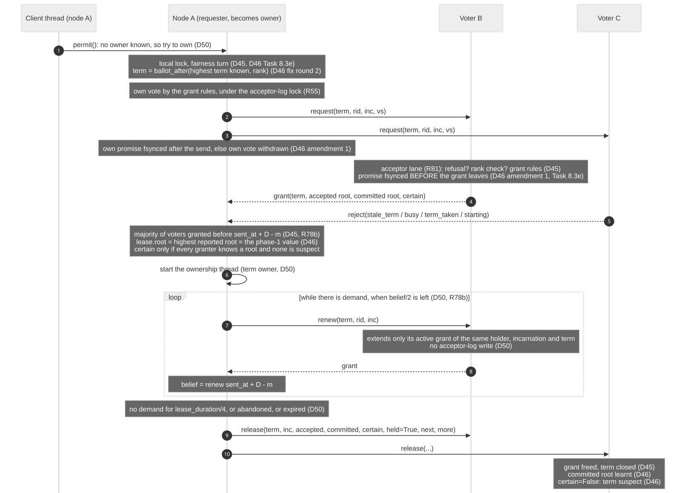

   Lease acquisition (phase 1), renewal and release.

1. **Local queueing and fairness (D45, D46 amendment Task 8.3e).** The threads of one process queue on a local
   lock; only the head thread asks. Before asking it defers to the member a release named as next (``next``,
   ``more`` and ``want`` are hints that time requests only; no grant reads them).
2. **The ballot (D46 fix round 2).** ``term = ballot_after(max(highest term seen, hint, accepted label,
   committed label), rank)``: the smallest term above everything this node knows whose low 12 bits are its rank.
3. **Own vote (R55).** The requester applies the grant rules to itself under the acceptor-log lock, sends
   ``request(term, rid, inc, vs)`` to the other voters *(m2, m3)*, then makes its own promise durable; if that
   write fails, its own vote is withdrawn.
4. **A voter decides (acceptor lane, R81).** It refuses when it is fenced, a learner, has no loaded log, its
   tier failed, or it is rejoining; when the term does not carry the requester's rank (``bad_ballot``); during
   its startup grace (``starting``); when the term is below the highest seen (``stale_term``); while another
   holder's grant is active (``busy``, with the remaining promise); when the term was already granted or closed
   here (``term_taken``). Otherwise it grants: the promise is ``fsync``-ed, then the ``grant`` leaves *(m4)*,
   carrying its accepted root (with label), its committed root and ``certain``.
5. **Winning (D45, D46).** The requester wins with grants from a majority of voters received before
   ``valid_until = sent_at + lease_duration - drift_margin`` on its own clock, measured from the moment the
   request was *sent*. It takes the highest root reported by its granters (and its own accepted root) in root
   order: that is ``lease.root``, the **phase-1 value**. The lease is **certain** when every granter knows a
   root, none reported a suspect term, and the requester is not suspect itself. If a granter reports a root
   labelled at or above the attempt's term (a cluster restarted with low terms), the attempt counts as lost and
   the next one goes higher.
6. **Losing.** A requester that cannot win broadcasts a cancel (``release`` with ``held=False``) and backs off:
   a jittered exponential delay within ``backoff``, extended up to the remaining promise a ``busy`` refusal
   reported, ended early by any release (D45, R39).
7. **Owning (D50).** The winner starts an ownership thread. While it has demand (a permission request in the
   last ``lease_duration / 2``, or one outstanding or queued), it **renews** when half of its belief is left
   *(m7)*: ``renew`` for the same term. A voter extends only its active, unreleased grant of that holder,
   incarnation and term, to ``now + lease_duration`` on its clock; a renewal writes nothing to the acceptor
   log, because the promise of that term is already durable *(m8)*. A renewal is decided before the stale-term
   rule: a higher term that was only requested (and refused ``busy``) promised nothing.
8. **Releasing.** Without demand for ``lease_duration / 4``, the owner releases *(m9, m10)*: the release closes
   the term at every receiver (a delayed duplicate of the request is refused), carries the committed root, and
   carries ``certain = not suspect``. An uncertain release marks the term suspect at its receivers.

**The timing argument, and why it is not a safety premise.** Let timers run at rates within ``[1 - rho,
1 + rho]``. A granter keeps its promise for ``D`` on its own timer from a moment after the request's send; the
holder believes for ``D - m`` on its own timer from the send. With ``m >= 2 rho D / (1 + rho)`` the belief ends
before every promise (D45). The code requires ``drift_margin`` of at least ``MIN_MARGIN_FRACTION = 2/3`` of
``lease_duration`` (R78b): the holder believes for at most a third of the promise, which covers timers up to
three times apart. This only keeps two holders from wasting each other's work. What keeps commits safe is the
ballot rule: once a majority has promised a newer term, no root of the older term can gain a majority, whatever
the older holder's timer says (D46 amendment Task 8.3f-B, R82).

The fencing token
~~~~~~~~~~~~~~~~~

The fencing token of D44 is, in the code, **the term itself**, checked at two places:

* **At the voters**, by the ballot rule: a replicated root labelled below a voter's ``granted_top`` is refused.
  This fences a holder whose lease ended without its knowing (a pause, a partition, a slow timer).
* **At the object store**, by the persisted-root compare-and-swap: the root object carries the label, and a
  persister never replaces a root that orders at or above its own in ``(label, epoch, ...)`` order.

``lease.py`` still defines ``FencingToken(term, epoch)`` and ``Lease.fencing_token`` from D45, when the holder
itself published the root with ``expected_epoch``; no code path uses them since D46 moved the store write to the
persister.

Terms and phase 1
-----------------

Every root carries a **label**: the term under which it was replicated (``SpaceRoot.cluster_term``, with
``cluster_epoch`` and ``cluster_previous``, the predecessor). Roots are ordered by ``(label, epoch)``, as Raft
orders a log by ``(term, index)``; ordering by ``(epoch, term)`` was shown unsafe with a fork (D46).

Choosing the base of a term's first root
~~~~~~~~~~~~~~~~~~~~~~~~~~~~~~~~~~~~~~~~

The first root of a new term is accepted over any older term's root by the ballot rule alone, so **the holder's
choice of base decides what the history keeps**. The rule (``_lease_base`` in ``transactions.py``):

1. **A certain lease or permit**, or a permit issued on a proposal (D55): the base is ``lease.root`` as given.
2. **An uncertain one**: the holder runs a **recovery round** (``recover_root``): ``query`` with ballot 0 to the
   other voters, ending once a majority of witnesses (this node included when it is one) has answered (D46;
   ``1b3a188``, Task 8.3n fix round 3). Before that commit the round waited for every voter, but went on with a
   majority after ``request_timeout`` when an answer was late, so it could already end at a majority. Committed
   roots in the answers are learnt as committed knowledge; the highest accepted root is the result. The round
   also clears the suspicion this node held *when the round was sent*, and only that one: a term whose outcome
   became unknown while the round ran may have replicated a root after some answers were given (re-review 5,
   C1).
3. **The phase-1 floor (R127, ``276a256``).** The base is the higher, in root order, of ``lease.root`` and the
   recovery result. The recovery query promises nothing, so its answers say nothing about roots accepted after
   they were given; the phase-1 value was reported by granters that had already promised the term
   (``_phase_1_floor``). A permission carries the owner's phase-1 value or a root the owner later knew
   committed, which is above it.
4. **Nothing known anywhere** (empty disks, or a majority of disks lost): the cluster **refounds** from the
   persisted root, with the term floor raised by ``REFOUND_TERM_STEP = 2**44``, so roots a lost node accepted
   after the persisted one (labelled far below) are superseded instead of resurrecting when it returns (D46,
   fix round 2).
5. **Stale base.** The base is stale when this node knows a committed root labelled above the term (or
   labelled exactly the term: for a plain lease always, under a permission when it orders above the base
   chosen in steps 1 to 4, that is after the recovery and the floor), when the base itself is labelled above the term (or exactly the term, for a plain lease), or when a
   refound raised the term floor (steps 4 and 6). Every commit, the attach confirmation included, runs under a
   permission (``_commit_under_lease``), so in practice: the round sends nothing, its commits are put back at the
   head of the node's queue for its next permission (``_requeue``; they get no error), and the permission ends
   ``unknown``, so the owner abandons the term (O6) and the next owner's phase 1 starts above it. Two
   exceptions keep another outcome: a permit issued on a proposal (D55, H2), whose superseded base ends
   ``none``; and a held-retry round of a permission already ``committed`` (D-LIVE-2, ``_PERMIT_RETRIES``), which
   keeps ``committed``, since its earlier round's root did commit.
6. **Hard guard (D46 fix rounds 3 and 4).** The base never orders below the committed root this node knows.
   If it would, acceptor logs were lost beyond the failure model; when the known committed root is the
   persisted one (or older) the cluster refounds from the persisted root, otherwise the commit raises
   ``ProtoCorruptionError`` naming the operator's remedy (``force_rejoin()``).
7. **Re-commit an uncommitted base (D46, R50).** When the base is not known committed here (and is not a
   proposal), the round first replicates an unchanged root on top of it, with the base's records the object
   store lacks (``_commit_base``), so transactions that start from the committed root see it.
8. **An unreachable base abandons the term (R133, ``db1a4c8``).** If some record of that base is on no
   reachable member and not in the object store, ``_commit_base`` raises ``_BaseUnreachable`` (a
   ``ProtoConflictError``: nothing was replicated, the commits retry) and the permission ends ``unknown``, so
   the owner abandons the term (O6) instead of issuing the same base again (O5). A floor root accepted only by
   members now down would otherwise stall every round of the term while a majority is alive (re-review 3, I1).
   Safety: abandoning is always conservative (P5). Progress, with a majority alive and at most ``f`` members
   down:

   * If the base R was acknowledged, a majority of voters accepted it, and by the copies rule ``f + 1`` members
     hold its records durably; one of them is live, so ``commit_records`` finds them unless its answers are late
     (a liveness matter).
   * If R was not acknowledged, abandoning does not drop it by itself. The next phase 1 runs on the live voters;
     each promises a ballot above R's term, so R can never be chosen *in its own term*. Its floor is the highest
     root those live voters accepted, and it may report R again. A live voter accepted R in one of two ways:
     with R's records in its own synced entry (it holds them), or with the root alone, which a voter accepts only
     once the replication names ``f + 1`` durable copies (D54), at least one of them on a live member. Either way
     a floor that reports R again can re-commit it with its records, and the next term makes progress.
   * The stall arose from the remaining case: a root accepted only by its committer (whose acceptance carries the
     single copy on its own disk) and by members now down. No live voter reports it, so the next floor does not
     return it. One abandoned term is therefore enough.

**Why the floor is sufficient (R127, D46 amendment Task 8.3n).** Let a root C be chosen (accepted by a majority
``Q_c``) in a term ``T_c`` below the lease's term ``T``, and let ``Q_g`` be the granting majority. They share a
voter ``m``. ``m`` promised ``T`` before it replied to the grant, and refuses every root below its promise, so it
accepted C before it replied; its reported root orders at or above C, because an accepted root only moves up
(and a voter that lost its disk regains a root at or above it through its rejoin ballot before it votes again,
R78a). So ``lease.root`` orders at or above C. Every root at or above C extends C, by induction over terms
(every earlier first root obeyed this rule) and, within a term, by **two** premises:

* V2', checked at each acceptor: an acceptor's roots of one term form a chain;
* S2 (R79): the owner issues each base once, so all roots of one term that reach acceptance lie on *one* chain
  across acceptors. V2' alone does not give this. If an owner issued one base twice, an uncommitted sibling of a
  committed root could reach acceptance with a higher epoch, order above C and not extend it (see "What S4 rests on" in
  `The owner's rules, O1 to O8`_).

A recovery result above the floor is a root some voter accepted, so, under the same two premises, it extends C
too. No step uses time; the S2 premise is the accepted boundary of R79, pinned by a strict expected-failure
test.

Failover
~~~~~~~~

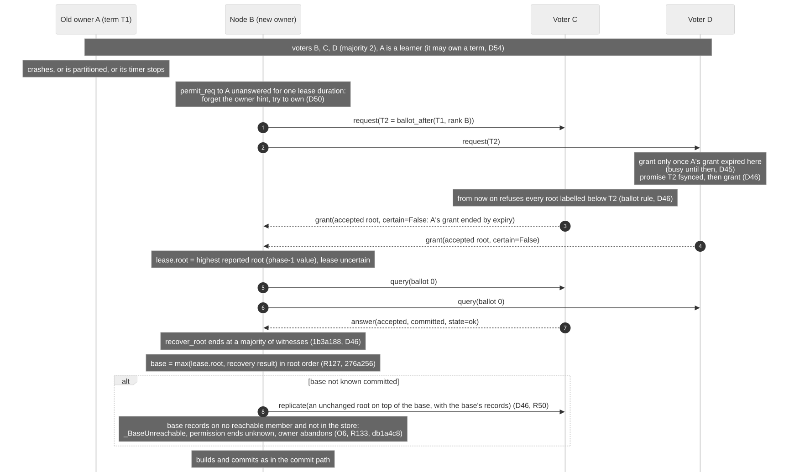

   Failover: the owner disappears, a new owner runs phase 1 and recovers its base.

1. A member whose ``permit_req`` gets no answer within one ``lease_duration`` forgets the owner hint and tries
   to own (D50). (A lost request or permit is first retried every ``request_timeout``; the owner answers a
   retry with the same permit, rule O7.)
2. The voters refuse it (``busy``) until the old owner's grant has expired on their clocks; then they promise
   the new term durably and grant *(m3, m4)*. Their replies are uncertain: the old grant ended by expiry, so they
   cannot know what its holder did (D46).
3. From each promise on, that voter refuses every root of the old term (ballot rule): the old owner and its
   holders, if they still run, can no longer complete a majority.
4. The new owner's lease is uncertain: recovery round, floor, and re-commit of the base as described above
   *(m5 to m8)*.

Phase 2: permissions and the commit point
-----------------------------------------

Before D50 every commit acquired the lease. Now the owner keeps its term while there is demand and grants
**permissions**; each permission lets one member run one commit round of its own transactions and replicate it
itself. The lease costs a grant round per owner change, none per commit (D50).

The commit path
~~~~~~~~~~~~~~~

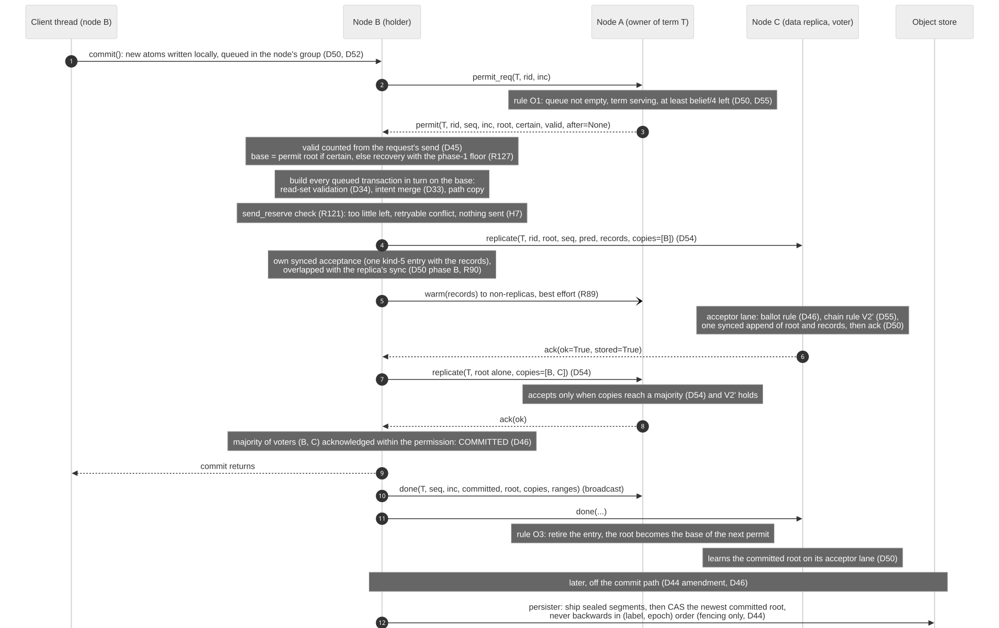
         voters, then the asynchronous persister.

   The commit path, three voters, ``f = 1``: B commits, A owns the term, C is B's data replica.

1. **Before any permission.** The transaction's new atoms are written to the local tier; its commit joins the
   node's group: one round runs per node at a time, and the thread that finds none running takes everything
   queued (D50, D52; Task 8.3h, ``d033425``: commits that queued while the runner waited join its first round).
2. **Asking (m2).** ``permit_req(term, rid, inc)`` to the owner the node knows; with no owner known, the node
   tries to own (`The peer lease`_).
3. **Issuing, rule O1 (D50, D55).** The owner issues the next permission when its queue is not empty, the term
   is serving (not abandoned, not ended, lease valid), the R80 drain allows it, at least a quarter of its belief
   is left (otherwise it renews first), the pipeline holds at most ``DEPTH`` entries, and the newest entry, if
   any, has proposed and has not been issued on. ``permit(term, rid, seq, inc, root, certain, valid, after)``
   *(m3)* carries the owner's base and ``valid``, the owner's remaining lease. The base is the newest root the owner
   knows committed (``certain``), except for the first permits of an uncertain lease, which carry its phase-1
   value uncertain (the holder then recovers, step 5), and pipelined permits, which carry a proposal.
4. **Holding (D45, protocol 9).** The holder measures ``valid`` from the moment it *sent* its request, so a
   permission never outlives the owner's lease on the holder's clock. A permit issued to another incarnation is
   dropped unanswered; a duplicate ``(term, seq)`` is ignored; a permit nobody waits for is handed back at once
   with ``done("none")``.
5. **Base and build.** The base follows `Choosing the base of a term's first root`_. Each queued transaction is
   built in turn on the root the previous one produced: read-set validation (D34), intent merge (D33), path
   copy; a conflicting transaction fails alone. Records of the base come from the cache (R89) or are fetched
   from the members the locator names, then from every member, then from the object store (D54).
6. **Reserve (R121).** Before anything a voter may accept leaves the node, the permission must have at least
   ``send_reserve`` left; otherwise the round ends with a retryable ``ProtoConflictError`` and nothing is sent
   (H7). A node also never replicates under a term below its last rejoin ballot (D50 amendment after R78a).
7. **Data stage (D54, R90).** ``replicate(term, rid, root, seq, pred, records, copies=[self], ranges, vs)``
   goes to the ``f`` data replicas *(m4)*; the holder's own synced acceptance (one kind-5 entry with every record
   of its round) runs while they sync. Members that are not data replicas receive the records in ``warm``
   messages, kept in memory only, best effort *(m5, R89)*.
8. **Acceptance at a voter (m6).** On its acceptor lane the voter checks: running and not refusing, the ballot
   rule, ``label == term``, root order not below its accepted root, V2', the permission ``seq`` not below the
   highest it accepted in that term, no sibling, and the copies rule. It accepts by one synced append of root
   and records, publishes, then acknowledges (``ack(ok, stored)``). A data replica stores the records with one
   synced entry whether or not it accepts the root, and reports ``stored``.
9. **Root alone (m7, m8).** After its own append and ``f`` ``stored`` acknowledgements, the holder sends the
   root alone to the other voters, naming the ``f + 1`` copies; they accept by the same rules.
10. **The commit point (D46).** The root is committed when a majority of voters (the holder included) has
    acknowledged it *and the holder observed that majority within its permission*. The commit returns *(m9)*.
11. **Ending the permission (m10, m11).** ``done(term, seq, inc, outcome, root, copies, ranges)`` is broadcast:
    the owner sequences on it (on its dispatcher, without waiting for its own copy of the replication, R81);
    every member learns the committed root on its acceptor lane, after the sender's earlier replications on links
    that keep the sender's order, and learns where the records are (D54 locator).
12. **Persistence (D44 amendments, D46).** Later and off the commit path, each persister ships its sealed
    segments in creation order, then writes the newest committed root once every record it references is in the
    object store, by compare-and-swap that never moves backwards *(m12)*. Any node persists when the oldest
    unpersisted commit it knows has waited more than ``persist_lag`` (a crashed committer).

**Held retries (D50 amendment, D-LIVE-2).** When a transaction of a round conflicts and ``Database.run`` will
retry it, the round keeps the permission (up to ``_PERMIT_RETRIES`` extra rounds while it is valid) and waits up
to ``_RETRY_HOLD`` for the retry, which starts from the root the round just committed; the conflict is marked
``permit_held`` and retried at once. Safety is unchanged: a kept permission is the same permission.

The owner's rules, O1 to O8
~~~~~~~~~~~~~~~~~~~~~~~~~~~

The owner (``_dispatch``, ``_permit_outcome``, ``_on_propose``, ``_own_loop_body``) keeps a pipeline of at most
``DEPTH + 1`` issued permissions and sequences it (D55):

O1
   Issue only as stated in step 3 above.
O2
   Issue on the newest entry's proposal once (the permit names it in ``after`` and is never ``certain``).
O3
   A ``committed`` done retires that entry and every older one (a successor's commit implies its
   predecessor's, Lemma C of D55) and its root becomes the committed base; a permission that proposed must report
   exactly its proposal, or the term is abandoned.
O4
   A ``propose`` from an unknown entry or incarnation is ignored, a duplicate is ignored; a changed proposal, a
   proposal from an entry that is not the newest, or one not built on the base it was issued is a reason to
   abandon the term.
O5
   A ``none`` from the only entry, which did not propose, removes it and the next permit reuses the committed
   base (D50). Any other ``none`` abandons the term (R124: a reserve refusal after a proposal costs the term, a
   conservative outcome).
O6
   Any other outcome it cannot sequence abandons the term: ``done("unknown")``; a ``done`` from another
   incarnation than the one the permission was issued to (protocol 9, 8.3f review C1); no ``done`` within
   ``valid + request_timeout``; the lease expiring with a permission outstanding (8.3f review I3).
O7
   A retried request whose permit is outstanding gets the same permit again, never a second one.
O8
   The term ends (idle, or the R80 drain) only with an empty pipeline.

**Abandoning a term (D50).** The owner marks itself suspect for the term, refuses its queue (``permit_no``,
reason ``abandoned``) and releases the lease as uncertain. The next owner's phase 1 decides what that term left:
its granters stop accepting the old term's roots and report their accepted roots; the base never orders below
the highest of them.

**What S4 rests on (R79).** If the owner issued one base twice, S3 would still prevent two conflicting roots
from both being committed, but a later phase 1 could prefer an uncommitted sibling of the same term with a
higher epoch. The design accepts that S4 rests on the owner's sequencing *code* being correct, as Raft rests on
its leader, and not on timers or message timing; a per-permission phase 1 would remove that dependence at the
cost of a synced promise at a majority for every commit, which this design exists to remove. A planted owner
that issues one base twice is kept as a strict expected failure:
``tests/unit/test_cluster_permit_incarnations.py::test_a_faulty_owner_issuing_one_base_twice_cannot_lose_a_commit``.

Pipelined permissions and the holder's rules
~~~~~~~~~~~~~~~~~~~~~~~~~~~~~~~~~~~~~~~~~~~~

With ``DEPTH = 1`` the owner may issue permission ``k + 1`` on the root that permission ``k`` *proposed*, before
that root is committed (D55, Task 8.3k; rulings R91, R93, R94). Its cost and benefit are in
:doc:`design-guide/pipelined-permits`.

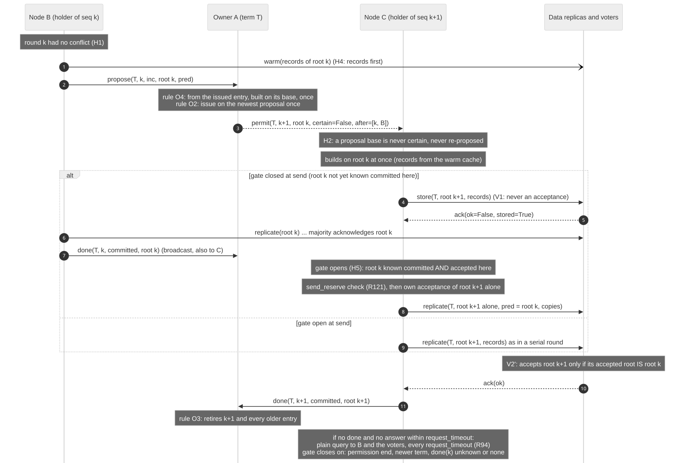
         then the root after the gate opens.

   Pipelined permits: B proposes root k, C builds root k+1 on it.

H1
   Only a round in which no commit conflicted proposes its root; a permission that proposed runs no further
   round.
H2
   A permission on a proposal base is never certain, is never re-proposed by ``_commit_base``, and its base is
   not learnt committed when the permit arrives.
H3
   Records carried by ``records``, ``replicate`` and ``store`` are cached on receipt, so the next holder can
   build before the lane has made them durable.
H4
   A proposing holder sends its ``warm`` records before its ``propose``, and both before its own append.
H5, the gate
   Nothing a voter may accept leaves the node, and no own acceptance is logged, until this node knows the
   proposal base committed **and** holds it as its accepted root. While the gate is closed the data stage is a
   ``store``: one synced store-only entry at each data replica, answered ``ack(ok=False, stored=True)`` (V1).
   Any cluster knowledge opens the gate (a ``done``, a permit, a release, a recovery answer); after
   ``request_timeout`` without it, a plain ``query`` goes to the proposer and the voters, again every
   ``request_timeout`` (R94). The gate closes, never to reopen, when the permission ends, the node stops, a newer
   term is seen, a committed root of the term above the base is known, or the predecessor's ``done`` reports
   ``unknown`` or ``none``.
H6
   A proposing holder sends its ``done`` right after its replication: its successor's gate waits for it.
H7
   The outcome rule of the `Invariants`_ table.

The gate is a liveness and outcome-quality rule, not a safety rule: voters verify by extension (V2'), so a wrong
gate would cost a refused root or an honest unknown, never a fork (D55, "a gate as a safety rule" rejected).

Outcomes: none, committed, unknown
----------------------------------

Every permission ends with one of three outcomes, which its ``done`` reports to the owner. The result each
commit of the round gets is a separate matter: two cases end the permission ``unknown`` although nothing was sent,
because the owner must not issue the same base again.

``committed``
   A majority of voters acknowledged the round's last root within the permission. The commits return normally.
``none``
   Nothing a voter may accept left the node and no own acceptance was logged (H7), and the base may be issued
   again: every commit conflicted, the reserve refused the send, the gate closed, or a proposal base was
   superseded (H2). The commits get ``ProtoConflictError``, which ``Database.run`` retries. Under rule O5 a
   ``none`` lets the owner reuse its committed base.
``unknown``
   * Something acceptable left, and the majority was not observed in time, or a failure followed the send. The
     commits get ``ProtoOutcomeUnknownError`` (D44 amendment R35), which is never retried automatically: the root
     may or may not take effect. A majority observed only after the permission had ended is reported the same
     way (D46 fix round 5, item 3).
   * A stale base (`Choosing the base of a term's first root`_, step 5): nothing was sent, and the commits are
     put back in the node's queue for its next permission, with no error.
   * An unreachable base (step 8, R133): nothing was sent, and the commits get a retryable
     ``ProtoConflictError``.

   In every case the owner abandons the term (O6).


   A permission at its holder, and its outcome.

**How an unknown outcome is resolved (R86, R123).** An unknown outcome is a legitimate, conservative result
(P5). The owner abandons the term; the next owner's phase 1 decides. If the root reached a majority, the
phase-1 value orders at or above it and it stays in the history (S4, R127). If a minority accepted it, a later
phase 1 may adopt it (a granter reports it) or drop it forever (no granter does, and the ballot rule then
refuses it everywhere): both are correct, because it was never acknowledged (R123). The application learns
which by reading: after the cluster converges, every acknowledged commit is present, and every unknown one is
present on every member or absent on every member.

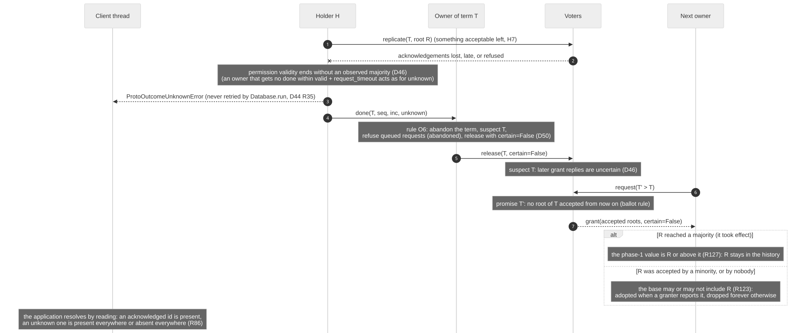

   An unknown outcome and its resolution.

Node states
-----------

What a member's votes and answers are worth at each moment (``_refusal``, ``_witness_state``):


   Member states.

* **Tier failed (R57).** A failed write on the attached tier (an acceptor-log write, or the records an
  acceptance or a commit vouches for) is never acknowledged nor granted; from then on the node refuses every
  grant and replication (``tier_failed``), answers ``unknown``, and ``acquire`` raises. Closing the space and
  reopening it on a healthy disk brings the node back.
* **Fenced.** An unexpected exception in a lane thread fences the node for the life of the process (a bug, not
  an I/O failure). A failure of the persister only stops persisting on that node (D46 fix round 2, item 3).

A term at its owner:


   Term states at the owner.

Crash and rejoin
----------------

**A process crash with its disk intact.** The restarted process draws a new incarnation. Attaching the space
loads its acceptor log: the promise is restored (``PeerGrants.restore``), so no term it granted is granted again;
the accepted root is restored, so the ballot rule and V2' keep their state. A request from the new incarnation of
a member holding an active grant ends that grant, reported as an expiry (its holder may have used it). The
startup grace (``startup_grace``, default ``restart_grace = lease_duration + drift_margin``) refuses grants for
that long after the start, so a lease the previous life granted is not overlapped; acceptances are allowed
during it (D50). Since R82 the grace is an efficiency property: a restarted node that granted early would cost
at most the running holder's work, because its replications are refused once a majority promised the newer term
(D46 amendment Task 8.3f-B). ``attach`` still refuses a shorter grace on a non-empty log.

**The confirmation commit after every attach (D46).** A node that attaches a space knows only what its log
recorded; a commit made while it was down, or whose ``done`` it missed, may be known committed only by others,
and its own logged committed entry may have been lost in a power loss (it is not synced on its own, R67). So
after every ``attach`` the coordinator reports ``needs_confirmation``, and the space's first snapshot first runs
an empty commit under a permission (``_confirm_build`` through ``_commit_under_lease``): its base comes out of the
owner's phase 1 (or a recovery with the phase-1 floor) and is committed if needed, so this node then knows a
committed root at or above every acknowledged commit. Only then does the snapshot read. Reads therefore never go
backwards across a restart. The attempt is made once per attach: a timeout, a conflict or an unknown outcome is
logged and tolerated, and the read then starts from the newest committed root the node knows, an older but
committed state, never a wrong one. When the node knows no committed root at all, ``current_root`` also runs a
recovery round, and reads the persisted root if that fails.

**A node that lost its disk: the rejoin ballot (R78a).** An empty acceptor log cannot tell a member that joins a
cluster's first start late from a wiped one, and a wiped node may have acknowledged a root just before the loss,
under a lease whose holder may still count that acknowledgement. The first fix waited ``restart_grace`` on the
node's own timer; a review probe lost an acknowledged commit with the wiped node's timer running 1.3 times as fast
as the holder's (:doc:`design-guide/coordinator`, "A mistake: a rejoin that waited for time"). The rejoin is now
a ballot (``9ef6307``):

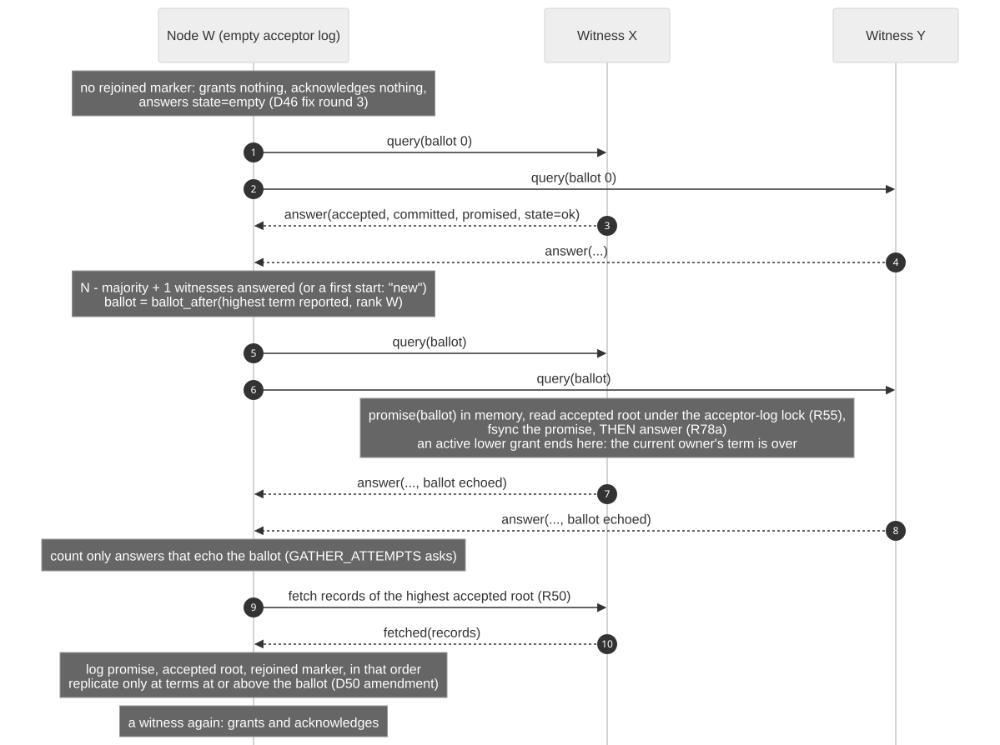

   A rejoin of an empty acceptor log.

1. Without the rejoined marker the node grants nothing, acknowledges nothing, and answers ``state=empty``.
   Every count below is over the **voters**: ``V`` is the number of voters, a majority is ``floor(V/2) + 1`` of
   them, and learners answer ``state=learner`` and never count (D54). A learner needs no rejoin at all.
2. A plain round (ballot 0) to the other voters learns the highest term anyone reports *(m1 to m4)*. Three
   decisions are possible (``_rejoin_decision``):

   * ``"new"``, a cluster's first start: every other voter answered, none has accepted a root, and none reports
     any term (R51). The node completes at once, without a ballot.
   * ``"rootless"``: every other voter answered and none has accepted a root, but some term was seen (a lease
     granted before the first commit). It goes through the ballot round below, like ``"witnesses"``.
   * ``"witnesses"``: at least ``min(V - 1, V - majority + 1)`` witnesses answered (``_rejoin_answers``).
3. The node picks ``ballot = ballot_after(floor, rank)``, where ``floor`` is the highest of every promise and
   label the answers reported, its own highest term seen and its term hint, and asks again *(m5, m6)*. A
   witness raises its promise to the ballot in memory (an active lower grant ends there, so the current owner's
   term is over), reads its accepted root under the acceptor-log lock, makes the promise durable, and only then
   answers, echoing the ballot *(m7, m8)*. Missing answers are asked again, up to ``GATHER_ATTEMPTS`` rounds.
4. Only answers that echo the ballot count, and ``V - majority + 1`` of them are needed. They intersect every
   majority M of voters that acknowledged a root R: M has at least ``majority - 1`` voters besides this node, and
   ``(majority - 1) + (V - majority + 1) = V > V - 1``, the number of other voters. That witness either accepted
   R before its promise (and reports R or above) or never accepts R afterwards, because R's label is below the
   ballot. Why it is below: R's term was granted by a majority of voters before the wipe, the witnesses of the
   plain round intersect that majority by the same count, and a granter reports the term it promised; the ballot
   is above every reported term. No timer appears.
5. The node fetches every record of the highest accepted root, commit by commit back to the persisted root, or
   confirms the object store holds them (R50) *(m9, m10)*: a root travels with its records. Records it cannot
   obtain leave it rejoining, with the reason in ``stats()["rejoin_blocked"]``.
6. It logs the promise, the accepted root and the rejoined marker, in that order, and is a witness again. It
   never replicates under a term below its rejoin ballot (D50 amendment after R78a).

The cost is one ballot per rejoin of an empty log, which ends the current owner's term.

**Losing a majority of acceptor logs.** Outside the failure model (at most one acceptor log lost at a time, with
its records, R48). A rejoin cannot gather enough witnesses; once an operator has established the loss,
``force_rejoin()`` on the wiped nodes lets them complete with a bare majority (D46 fix round 12, item 8). Commits
not yet persisted may be lost; the persisted state is always complete and readable, and the refounded lineage
supersedes stale survivors (D46). A commit not yet in the object store whose ``f + 1`` copies are all lost is
lost (D54: no re-replication).

The 8.3n round 3 mistake
------------------------

This is the protocol's most instructive mistake, kept here as a worked counterexample. The design guide tells
how it was found and why it had survived (:doc:`design-guide/unknown-outcomes`, "The mistake: a recovery round
that ended too early").

**The change, and the older hole.** Task 8.3n fix round 3 (``1b3a188``) made the recovery round end as soon as a
majority of witnesses had answered, instead of waiting for every voter. Its justification was the classic
argument: every committed root was accepted by a majority, which intersects the answering majority. The base of
an uncertain lease was taken from the recovery result alone. **The hole predates that commit.** The earlier round
also went on with a majority once ``request_timeout`` had passed with an answer missing, and under P5 an answer
may always be late, so the same schedule was possible before; ``1b3a188`` made it the normal path and wrote the
false argument down as its justification (re-review 2 of 8.3n, C1).

**The counterexample** (five voters a to e; ballots ``4096 = 1 x 4096 + 0``, ``4100 = 1 x 4096 + 4``,
``8192 = 2 x 4096 + 0``). It needs three faults, all inside the failure model: e's timer runs slow; e's
``replicate`` to c is delayed; and a's lease requests to c and e are lost, or delayed until after step 5. The
last one matters: had a's request reached c first, c would have granted ``T`` (e's grant having expired on c's
clock), promised 8192, and then refused R' by the ballot rule, and the schedule would fail.

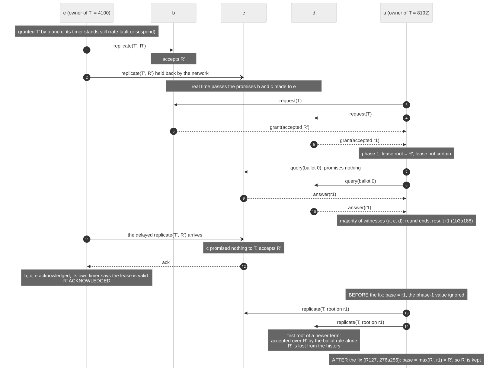
         acknowledged root R prime.

   Finding C1 of the round 3 re-review: before and after the fix.

1. e owns ``T' = 4100``, granted by b and c; its timer stands still.
2. e's ``replicate(R')`` reaches b; its copy for c is held back.
3. Real time passes b's and c's promises to e. a asks for ``T = 8192``; its requests to c and e are lost. b and
   d grant, so a owns ``T``; phase 1 reports R', so ``lease.root = R'``, and the lease is uncertain.
4. a's recovery round is answered by c and d: with a, a majority. It ends at once and returns an older root, r1.
5. The delayed copy reaches c. c has promised nothing to ``T`` (a recovery query promises nothing), so it
   accepts R'. e counts b, c and itself, 3 of 5, while its own timer says its lease is valid: **R' is
   acknowledged.**
6. a builds on r1 and replicates the first root of ``T``; every voter accepts it over R' by the ballot rule
   alone. **R' is not in the history.**

**Why the argument failed.** A majority answer is evidence about the past only if it was a promise about the
future. The lesson is not "ending at a majority is wrong": a round that waits for every voter but gives up waiting
after a timeout has the same hole, because an answer may always be late. It is that a ballot-0 answer is no evidence, at any count, about what its sender
accepts afterwards. Intersection proves that a member of the answering majority accepted every root chosen *before it
answered*; a ballot-0 answer says nothing about what it accepts after. The only sentence that excused it, "the
recovery round is sent under the lease, i.e. after every earlier lease ended", is a statement about clocks, and
under P5 it carries nothing.

**The fix (R127, commit ``276a256``, merged as ``359f128``).** The base of an uncertain lease or permission is
the higher of the phase-1 value and the recovery result (`Choosing the base of a term's first root`_, step 3),
with the sufficiency argument given there. Waiting for every granter instead was also safe, but rejected: it
waits ``request_timeout`` whenever a granter dies after granting, the stall ``1b3a188`` had removed. The floor
was not free: re-review 3 found that a floor root whose records live only on dead members stalls the term, fixed
by abandoning the term (R133, ``db1a4c8``, step 8). Tests: ``tests/unit/test_cluster_recovery_base.py``
(``test_c1_a_recovery_ended_at_a_majority_never_drops_the_phase_1_root``, the reviewer's schedule through the
product's ``_lease_base``; ``test_c1_an_uncertain_permission_base_never_orders_below_its_issued_root``;
``test_i1_a_floor_base_whose_records_are_unreachable_abandons_the_term``); the plants ``c1_no_floor`` and
``unreachable_base_none`` in ``tests/support/plant_defects.py`` make them fail.

Reads: local snapshots and linearizable reads
---------------------------------------------

Readers never wait (D44): a transaction reads the snapshot root it started from, for as long as it runs. The
cluster offers two ways to start one (R106 addendum).

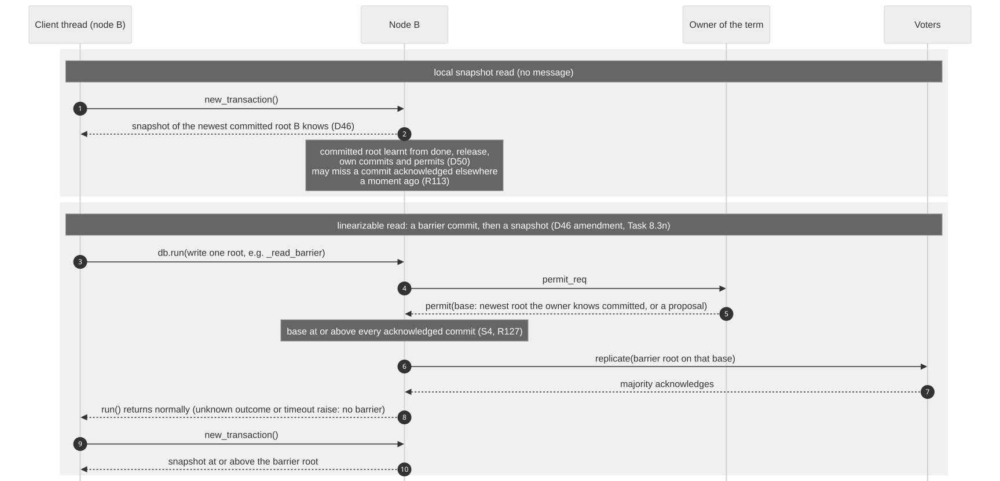

   A local snapshot read against a linearizable read.

**The local snapshot read.** ``new_transaction()`` takes the newest root this node knows committed. In steady
state this sends no message and does not wait. Two exceptions: the first snapshot after an ``attach`` waits for
the confirmation commit (`Crash and rejoin`_), and a node that knows no committed root runs a recovery round
first. The committed root is learnt from ``done`` and ``release`` messages, permits, grant replies, recovery and
rejoin answers, and this node's own commits (D46, D50). A commit another member acknowledged a moment ago may not have reached this node yet, so the read
can miss it. ``sync()`` does not change that: it is a durability barrier (every commit *this node knows* is
persisted), not a visibility barrier (D46 amendment, Task 8.3n; R113).

**The linearizable read.** To read every commit acknowledged anywhere before the read starts, the reading node
runs a **barrier commit**, then starts its transaction: for example
``db.run(lambda tr: tr.set_root_object("_read_barrier", True))``. The barrier asks the owner for a permission;
the permission's base is at or above every acknowledged commit (else S4 would be broken), and once the barrier is
acknowledged this node knows its own root as committed. It is a barrier only when it writes something (a
transaction that writes nothing obtains no permission) and returns normally (an unknown outcome, a conflict after
the retries or a timeout raise, and are no barrier). It costs a commit, permanently: a version in the history and
a root name. A read-only barrier (``ObjectSpace.read_barrier``) is proposed and **not implemented**; its contract
and its open case (a pipelined permit) are in D46's amendment of Task 8.3n. The tutorial
:doc:`tutorials/cluster` runs both reads.

Comparison with Datomic's ``d/db`` and ``d/sync``
~~~~~~~~~~~~~~~~~~~~~~~~~~~~~~~~~~~~~~~~~~~~~~~~~

Datomic Pro's peer API offers the same two kinds of read. Its documentation (consulted 2026-11-11) says:

* ``datomic.api/db``: "Retrieves a value of the database for reading. Does not communicate with the transactor,
  nor block." (`datomic.api <https://docs.datomic.com/clojure/>`__)
* ``datomic.api/sync`` with no ``t``: "Returns a future that will acquire a database value guaranteed to include
  all transactions that were complete at the time sync was called." It "Communicates with the transactor."
  With a ``t``: it "returns a future that will acquire a database value with basisT >= t" and "Does not
  communicate with the transactor." (`datomic.api <https://docs.datomic.com/clojure/>`__; the Java
  ``Connection.sync()`` page states the same guarantee: `Connection
  <https://docs.datomic.com/javadoc/datomic/Connection.html>`__)
* Guidance: "db is the preferred way to get a database value, as it does not need to wait nor block. Only use
  sync when coordination is required, and prefer the two-argument version when you have a basis t."
  (`datomic.api <https://docs.datomic.com/clojure/>`__)
* How a peer learns new data: "Recent datoms are cached in the memory index on the transactor and on all
  peers." "The transactor updates the memory index after it writes a transaction to the log." "A peer updates
  the memory index when notified by the transactor of a transaction." (`Memory and Caching
  <https://docs.datomic.com/operation/caching.html>`__)

The correspondence:

.. list-table::
   :header-rows: 1
   :widths: 22 39 39

   * -
     - Datomic Pro peer
     - ``proto_db`` member
   * - Fast local read
     - ``d/db``: the peer's latest known value, no transactor round trip.
     - ``new_transaction()``: the newest committed root this node knows, no message.
   * - Read that includes everything completed before the call
     - ``d/sync``: asks the transactor, then waits until the peer holds that basis.
     - A barrier commit: asks the owner for a permission and commits a root on a base at or above every
       acknowledged commit. It is a write; a read-only form is proposed, not implemented.
   * - Wait for a known point
     - ``d/sync`` with a basis ``t``, no transactor contact.
     - No public equivalent: there is no API to wait until this node's committed root reaches a given epoch.
   * - Who orders commits
     - The transactor, one process.
     - The owner of the current term issues permissions; a majority of voters accepts each root.
   * - How new data reaches readers
     - Novelty pushed by the transactor into each peer's memory index.
     - Roots and records pushed with the commit (``done``, ``warm`` to non-replicas, R89); a missing record is
       fetched on demand.

**The difference in grain.** Datomic pushes *datoms* into a peer's memory index. Its index page describes the
model as one that "Merges index trees with an in-memory representation of recent changes so that peers see
up-to-date indexes" (`Indexes <https://docs.datomic.com/indexes/index-model.html>`__), and its capacity page
says that "Datomic must perform background indexing jobs to copy recent changes from memory into the persistent
index" (`Capacity Planning <https://docs.datomic.com/operation/capacity.html>`__). Reading these together as "indexing the novelty is deferred
work" is our summary, not Datomic's wording. ``proto_db`` propagates *roots and records*: each
commit's records are the new nodes of the persistent trees, and **the root is already the index**. A member that
learns a committed root can read through it at once, with no merge and no index debt; the price was paid by the
committer, which built the path copies under its permission. Which trade-off suits a workload is not measured
here (R112).

Timers
------

Every timer of the protocol, with its default from the code. None of them decides an acceptance, an
acknowledgement or the truth of an outcome (R82; timer audits in D50, D54, D55). When one fires, the result is
always one of the conservative failures named at the top of this page.

.. list-table::
   :header-rows: 1
   :widths: 30 25 45

   * - Name (where)
     - Default
     - What it drives (liveness only)
   * - ``lease_duration`` (coordinator)
     - 2.0 s
     - How long a grant blocks other holders on the granter's timer.
   * - ``drift_margin``, ``MIN_MARGIN_FRACTION``
     - ``2/3 x lease_duration`` (the minimum)
     - The holder's belief is ``lease_duration - drift_margin``: a third of the promise (R78b).
   * - Renewal (``_own_loop_body``)
     - at half the belief left
     - When the owner renews while it has demand. A failed renewal does not end the term: the owner retries, and
       the term ends when its lease expires; if a permission is then outstanding, the owner abandons the term
       (O6). Holders may still commit within their own validity.
   * - Permit floor (``_dispatch``)
     - a quarter of the belief left
     - No permission is issued with less left; the owner renews first (D50).
   * - Idle end (``_own_loop_body``)
     - ``lease_duration / 4`` without demand
     - When an owner releases its term (D50).
   * - ``owner_idle_release``
     - ``None`` (off)
     - Ends a term whose own threads stopped asking (R80).
   * - ``request_timeout``
     - 0.25 s
     - How long an attempt, a renewal, a recovery round or a query waits. Must be shorter than the belief.
   * - ``send_reserve``
     - ``min(request_timeout, belief / 4)``
     - Least validity left before anything acceptable is sent; less gives a truthful retryable conflict (R121).
   * - Permission deadline (``_Issued``)
     - ``valid + request_timeout``
     - An owner without a ``done`` by then abandons the term (O6).
   * - ``startup_grace``, ``restart_grace``
     - ``lease_duration + drift_margin``
     - Grants refused after a start (efficiency, D46 amendment Task 8.3f-B).
   * - ``backoff``
     - ``(0.001, 0.05)`` s
     - Jittered delay between lost attempts.
   * - ``_WAKE_SPREAD``
     - 0.003 s
     - Random spread after a release wakes a requester.
   * - ``_MIN_STRAGGLE``, ``_STRAGGLE_FACTOR``
     - 0.005 s, 4
     - Once a majority answered an undecided attempt, how long the rest are awaited (R39).
   * - ``_TURN_SILENCE``
     - 0.05 s (capped by ``request_timeout``)
     - How long a member defers to the member a release named (fairness, Task 8.3e).
   * - ``acquire_timeout``
     - 30 s
     - When ``permit()`` gives up with ``ProtoTimeoutError``.
   * - ``GATHER_ATTEMPTS``
     - 3
     - How many times a rejoin round asks a silent member again.
   * - ``fetch_timeout``
     - ``belief / 4``
     - How long a peer page request waits; never beyond the lease under a held permission.
   * - ``persist_interval``, ``persist_lag``
     - 0.05 s, 1.0 s
     - Persister passes; when any node persists another's commits.
   * - ``_RETRY_HOLD``, ``_RETRY_WAIT``, ``_PERMIT_RETRIES`` (``transactions.py``)
     - 0.1 s, 0.005 s, 3
     - Held retries under a permission (D-LIVE-2).
   * - Data replica hedge
     - ``request_timeout``; suspect for ``lease_duration``
     - When a silent data replica is replaced by the next successor (D54).
   * - Gate fallback
     - every ``request_timeout``
     - When a gated holder queries for its base's outcome (R94).

Where the code is
-----------------

``proto_db/cluster/coordinator.py``
   ``ClusterCoordinator``: grants (``_on_request``, ``_decide``), acquiring (``_become_owner``,
   ``_open_attempt``, ``_close_attempt``), ownership and the owner rules (``_dispatch``, ``_permit_outcome``,
   ``_on_propose``, ``_abandon``, ``_own_loop_body``, ``_renew``), permissions (``permit``, ``finish``),
   replication and acceptance (``replicate``, ``_may_accept``, ``_apply_replicate``, ``_apply_store``), the gate
   (``_await_gate``), recovery (``recover_root``), rejoin (``_rejoin_round``, ``_complete_rejoin``,
   ``_on_ballot_query``).
``proto_db/cluster/lease.py``
   The pure grant rules (``PeerGrants``), attempts and ``best_root`` (the phase-1 value), ``Lease`` and
   ``Permission``.
``proto_db/cluster/rootlog.py``
   ``root_key`` and ``compare_roots`` (the one order of roots) and the acceptor log.
``proto_db/cluster/persister.py``, ``proto_db/storage/tiered.py``
   Asynchronous persistence and the persisted-root compare-and-swap.
``proto_db/cluster/protocol.py``, ``proto_db/cluster/transport.py``
   Messages (protocol version 13) and the TCP and in-process transports.
``proto_db/transactions.py``
   The commit round under a permission (``_run_round``, ``_permit_round``), the base (``_lease_base``,
   ``_phase_1_floor``, ``_commit_base``).
