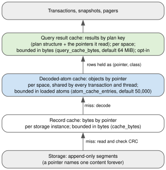

The cache layers
================

*Storage bytes, decoded atoms and query results: three caches, one key. Decisions D53 (and its Task 8.3i
amendment) and D56; rulings R75 and R76.*

What it gives the ERP
---------------------

The ERP tutorial counts the atoms each report loads from disk: 2,012 for the first pipeline report on a
freshly opened space, 0 for the same report in a new transaction, 6 for a related query. Behind those three
numbers are three caches, each answering a different question:

* *have I read these bytes before?* (the storage's record cache);
* *have I decoded this object before?* (the space's decoded-atom cache);
* *have I answered this query on this version before?* (the space's query result cache).

An application developer can ignore all three and still get the effect. A systems programmer needs to know
which layer answered, what each one holds, and what bounds it.

         layer below.

   The three layers. Each is keyed by pointer (or, for results, by a plan whose leaves are pointers), so none
   ever needs invalidating (:doc:`immutability`). Source: ``diagrams/cache-layers.dot``.

The problem
-----------

Each layer exists because the layer below it left a measured cost:

* **Record bytes.** ``FileStorage``, ``CloudStorage`` and ``TieredStorage`` keep a bounded cache of record bytes
  by pointer (``cache_bytes``). It was
  there before this design work; ruling R75 verified that it already served every transaction, and that each
  transaction still re-decoded what it read.
* **Decoded atoms.** Decoding was about 80 % of a point read (1,475 us per read, D53, before ``c78e4fd``). The
  decoded-atom cache took the read to 212 us (see :doc:`immutability`).
* **Query results.** Executing a range query with a residual filter over 10^4 rows cost 77 ms; a cache hit
  costs 3.9 ms (D56, Task 8.4b, recorded at ``e9afb72``, N = 10^5).

And a fourth cost appeared once the middle layer existed: **writing**. A commit saves new atoms, and the next
commit that builds on them used to read and decode them again. Task 8.3i made the decoded-atom cache receive
every saved atom already decoded (a *decoded twin*), so the next build on a root this node wrote reads and
decodes nothing: on a single node, 31 decodes per one-row build became 0 (D53, Task 8.3i amendment).

Why the obvious solution fails
------------------------------

The obvious design is **one cache with one bound**. It fails because the three layers hold things of
incomparable size, and the natural unit of each is different:

* record bytes are measured in bytes;
* a decoded atom is one object of any size, from a small record to a node holding a large value;
* a query result can be one row or 10^4 rows, and its key holds every operand of the query (an ``IN`` of 10^4
  strings is a large key).

A count of entries bounds nothing when one entry can be a megabyte. This was measured: before Task 8.3i's
bound, caching every saved atom decoded made a probe of 600 commits of 1 MB ``DBObject`` values on
``FileStorage`` grow RSS by **+612 MiB**; with a 4 KiB limit on what is cached decoded on save
(``SAVED_INLINE_MAX``), the growth was +170 MiB, against +175 MiB at ``26af257`` before the task (D53, review
8.3i I1, fixed in ``b937364``).

The alternatives and their costs
--------------------------------

* **Caching on save, or only on read.** Caching on save removes the decode of the next build (31 decodes to
  0, above). It does not pay on a bulk build: building a 480,815-object inventory took 153.3 s with the
  decoded-atom cache disabled, 165.8 s at ``26f3b85`` with it on, and 187.5 s once residency was added
  (D53, parked finding; the residency design's ladder, single runs). Each commit's twins are
  admitted and mostly evicted before anything reads them. Caching on save was not changed: the bulk case is
  recorded as a parked finding in D53, not hidden.
* **A per-transaction decoded cache.** Rejected in D53: the cost returns with every transaction.
* **Results shared across processes.** Rejected in D56 (see :doc:`immutability`).

The choice, and the invariant that makes it correct
---------------------------------------------------

Three layers, each keyed by pointer and each bounded in its own unit:

============================  ===================================  ==========================================
Layer                         Key and scope                        Bound
============================  ===================================  ==========================================
Record cache                  pointer; per storage instance        bytes (``cache_bytes``; file, cloud and
                                                                   tiered storages)
Decoded-atom cache            pointer; per ``ObjectSpace``,        loaded atoms (``atom_cache_entries``,
                              shared by every transaction          default 50,000; see :doc:`residency`)
Query result cache            plan structure + pointers read;      estimated bytes, key included
                              per ``ObjectSpace``; opt-in          (``query_cache_bytes``, default 64 MiB);
                                                                   an entry over 1/8 of it is not stored
============================  ===================================  ==========================================

**The invariant of the stack: an upper layer holds only identities of the layer below, never its state.** A
cached query result holds atom rows as ``(pointer, class)`` and resolves them through the decoded-atom cache
when they are read. So an upper layer never keeps a lower layer's content alive, and each layer's bound means
what it says. Together with P1 (the content at a pointer never changes), this is why no layer ever needs to be
told about a commit.

Its cost, stated honestly
-------------------------

* **Three settings to size**, and a request that misses all three pays all three: a storage read, a decode,
  and an execution. The decoded-atom cache has a measured signal for sizing it (:doc:`residency`); the query
  cache reports its own statistics (``query_cache_stats()``). Of the storages' record caches, only
  ``FileStorage`` reports counters (``cache_stats()``, informational); the others are sized by their byte bound
  (``cache_bytes``) alone.
* **The bounds do not add up to a memory bound for the process.** D53 lists what lies outside the
  decoded-atom bound: the query cache (its own byte bound); the storages' record caches (bytes); the vector
  indexes' derived structures (``DerivedCache``: matrices, IVF lists and HNSW graphs, process-wide, at most 16,
  bounded by count, not bytes); the stubs that resident atoms hold for their children (at most about 0.75 KB
  each); the identity map (one weak reference per live object); and everything transactions, readers and the
  application hold.
* **A cache miss can cost more than no cache.** A query-cache miss costs about 1.7x an uncached execution
  (D56), which is why that layer is opt-in.

What was tried and rejected
---------------------------

* One cache with one bound (above).
* Caching saved atoms with large inline values (above: the +612 MiB probe).
* Weights or derived data kept only in memory, never persisted, for the index used by pagers: rejected in D56,
  because the first use on a cold index would load the whole index (see :doc:`pager-and-rank`).

Back to the ERP
---------------

The three counters of the ERP tutorial now read precisely. The first report missed every layer and loaded
2,012 atoms. The second report found every atom in the decoded-atom cache: 0 loads, and no layer was told
anything. The related query found most of its atoms there and loaded 6. Had the report been run with
``.cached()``, a third repetition on an unchanged root would not even have walked the atoms: it would have
been one lookup in the query cache.

What none of the three layers could do on its own was bound the memory of the decoded objects. That is the
next chapter.
