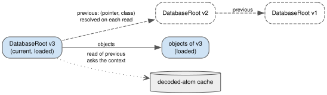

History links: keeping the past on disk, not in memory
======================================================

*Task 8.3l. Ruling R92; decisions D53 (Task 8.3l amendment), D46 and D32; principles P1 and P7.*

What it gives the ERP
---------------------

"What did the pipeline look like last Tuesday?" and "who changed this opportunity, and what did it look like
before?" are answered in the :doc:`ERP tutorial </tutorials/erp>` with no history table: ``db.history()``
lists every committed version of the database, ``snapshot_at`` opens one, and each opportunity points at the
version it replaced. Every version the ERP ever committed stays readable.

That raises a fair question for whoever runs the server: if every version stays reachable, does the process
keep every version in memory?

The problem
-----------

Each committed version of a database is a ``DatabaseRoot``, and each root links to the root it was built on
(``previous``; in a cluster, ``SpaceRoot.cluster_previous`` links the space roots too). Those links are
history: they are what makes "as of" work.

Before Task 8.3l, a new root held its loaded predecessor *as a Python object*, and every loaded root held its
own predecessor the same way. So every root a process had committed or loaded stayed in memory, together with
everything that had been loaded through it. The decoded-atom cache had a bound on its entries; the chain of
roots ignored it.

**Measured symptom** (D53, Task 8.3l amendment, probe ``chainleak.py``, 6,000 small commits on
``MemoryStorage`` with a 1,000-entry cache, at ``0ed9b9a``): **6,001 loaded** ``DatabaseRoot`` **objects and 121,694 loaded tree
nodes alive.** A 3-node in-process cluster, 1,200 commits with a 200-entry cache: 1,201 loaded ``SpaceRoot``
and 1,201 ``DatabaseRoot`` objects. The leak was found as ruling R92: "the decoded-atom cache's entry bound
is not a memory bound".

Why the obvious solution fails
------------------------------

* **"Evict old roots from the cache."** They were not held by the cache. Each one was held by its successor,
  and the newest root is always held. Evicting entries frees nothing that a newer root still reaches.
* **"Drop the link."** That removes the history: no "as of", no ``history()``, no audit trail. P1 requires
  history to persist; it does not require it to persist *in memory*.
* **"Add properties on the two root classes that load the predecessor on demand."** Considered and rejected
  in Task 8.3l: a property would shadow a persisted attribute, which the loading code
  forbids, and it would cover only the classes that remember to define it.

The choice, and the invariant that makes it correct
---------------------------------------------------

An atom class names its history links in ``_history_links`` (``DatabaseRoot.previous``,
``SpaceRoot.cluster_previous``). Such an attribute is **persisted exactly as before**, as a reference: the
format and the wire form did not change. **In memory the atom holds only** ``(pointer, class)``, and every read
of the attribute asks the atom's context to load it: through the space's cache when the context shares it,
else as a fresh stub. This is the existing stub mechanism (P7); no new kind of reference was added. Commits
``8a435b0`` and ``010d8f6``.

   ``previous`` is persisted as a reference and held in memory as a pointer. Reading it resolves it again.
   Source: ``diagrams/history-links.dot``.

**The invariant (P1): a pointer's content never changes.** Resolving ``previous`` twice gives two loads of the
same version, with equal content, so a reader cannot tell whether the predecessor was kept or loaded again.
Readers holding an old root, and "as of" walks of ``previous``, read correct content after the loaded forms
were evicted: tested alone (``tests/unit/test_history_links.py``) and with 3 writers and 4 readers, GIL on and
off, standalone and in a 3-node cluster walking both links (``tests/concurrency/test_history_readers.py``).

After the change the same probes give (D53): **25** loaded ``DatabaseRoot`` objects and 1,239
tree nodes after 6,000 commits; 6 ``SpaceRoot`` and 6 ``DatabaseRoot`` objects after 1,200 cluster commits.

Its cost, stated honestly
-------------------------

* **On the commit path**: building a root's state and its decoded twin now resolves the links through the
  context, a few microseconds per commit against a commit of milliseconds. The task measured this with a
  microbenchmark and with the cluster headline, but neither the probe nor its log is in the repository, so this
  guide quotes no figure for it. The measurement to repeat is the commit headline of :doc:`/performance` at
  ``0ed9b9a`` against ``010d8f6``.
* **Walking history costs reads.** Each step of ``previous`` loads a version again unless the cache still holds
  it. A long walk costs storage reads, never memory.
* **History costs disk, forever.** Nothing is ever reclaimed from the object store. With the benchmark's
  commit body, the store grew by 5.8 KB per commit after 600 commits and 6.9 KB per commit after 2,400 (D46,
  in-process 3 nodes x 2 threads). A long reader costs no disk beyond what history already costs,
  because nothing the store lacks is ever released locally.
* **Metadata still grows with history** (open item, D53): a tiered node keeps about 200 B per segment the
  object store holds and about 250 B per own segment ever written. That is metadata, not loaded state, and its
  pruning is scheduled.
* ``Database.history()`` **returns a list** holding every version's root: memory per call proportional to the
  history (D32; a lazy iterator is an open item).

A mistake: a bound that was argued, not measured
------------------------------------------------

Task 8.3l's amendment to D53 described what remained bounded after the fix: "a cached tree node can keep a
loaded subtree **of its version** reachable". It sounded small. It was wrong, and the next task measured how
wrong: because every saved atom entered the cache as a decoded twin whose children were the cache's own atoms,
"the subtree of its version" was every node the process had ever written or read in that tree. An inventory
build held 2.76 M loaded atoms and 2.76 GB with 50,000 entries (:doc:`residency`).

The history links were one instance of a general defect: *a loaded object pins what it has loaded*. Fixing the
instance that had been noticed, and then describing the remaining bound in words, left the general defect in
place. Task 8.3m's bound is checked differently: by a test that walks the graph from every cache entry and
asserts that nothing loaded is reachable outside the bound (on one single-threaded workload; see
:doc:`residency` for what the test covers and what rests on reasoning). **A memory bound is a claim about reachability;
check it by walking the graph.**

What was tried and rejected
---------------------------

* Properties on the root classes (above).
* Holding the link as a type name plus a stub built on demand: it took a registry lock on every save; the
  link now holds ``(pointer, class)`` and builds its persist stub directly (``010d8f6``).
* Weak references or edge rules for *all* edges: deferred to Task 8.3m, which rejected them for the reasons in
  :doc:`residency`. The two history links kept their pointer form (ruling R103-4): residency would also cover
  them, but removing working code would gain nothing (the maintainer's ruling on the 8.3m design).

Back to the ERP
---------------

The ERP keeps every version it ever committed, and the server pays for that history on disk, not in memory.
An "as of" report for last Tuesday loads the versions it reads and lets them go. An opportunity's own
``previous`` is an ordinary attribute set by the application, not a history link, so it is bounded the general
way, by residency: an audit walk of one opportunity's chain costs at most a read per version. The answers are
exact, because a version found by pointer is the version that was committed, however long ago it was evicted.
