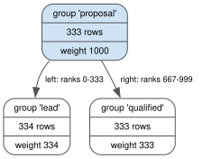

The pager and rank access
=========================

*Task 8.4b. Decision D56; rulings R77, R77a, R98 and R99; principle P1. The figures are those of D56,
measured on the Task 8.4b code (D56 recorded at* ``e9afb72``\ *), 5 interleaved runs per GIL mode on ZFS,
every sample verified against a model.*

What it gives the ERP
---------------------

A manager prints the report of open opportunities, most valuable first, 250 rows per page, while a colleague
keeps closing deals. In the :doc:`ERP tutorial </tutorials/erp>`, the usual approach (a fresh query per page,
"skip 250, take 250") produced two pages that **missed 40 of the first 500 rows**, because the deals won between
the two requests moved rows across the page boundary. The pager produced **959 rows, 959 distinct, exactly the
959 that were open when the report started**, and its token resumed the report later, in another transaction,
as it would in another process. The manager can also jump straight to the last page without reading the
pages before it.

The problem
-----------

Two problems, which the obvious solutions solve one at a time:

* **stability.** A report that spans several requests must see one version of the data;
* **random access.** Page *k* should cost the same as page 0, not grow with *k*.

**Measured symptoms** (D56, 10^6 unique keys, pages of 50 full rows, each request in a new transaction):

* before Task 8.4b, ProtoDB's ``Limit`` read an ordered scan up to the offset: **16.5 ms at offset 10^4 and
  12.3 s at 10^5** per request (the 10^5 figure dominated by loading index nodes and rows: the working set
  exceeded the 50,000-entry cache);
* a pager that materializes its result first spent **1.43 s** before its first page, whatever the page;
* SQLite's ``ORDER BY k LIMIT 50 OFFSET o`` on an indexed column: 35 us at offset 0, 3.0 ms at 10^5 and
  **42.5 ms at 9 x 10^5**: ``OFFSET`` reads and discards every earlier row.

Why the obvious solution fails
------------------------------

* **Offset paging** is O(offset) per page, and it is unstable: every page is a new query on a newer version,
  which is the ERP's 40 missing rows.
* **Keyset paging** (``WHERE k > last_key``) is fast and constant for the *next* page: SQLite answered in 36-48
  us at every offset. But it cannot jump: reaching offset *o* by chained keyset fetches cost 57 ms at 10^4 and
  596 ms at 10^5. And it is stable only if nothing is inserted before the cursor.
* **A server-side cursor, or a transaction held open** for the length of the report, gives stability by
  holding resources on the server for as long as a person reads. (Not measured here; it is the design this
  chapter avoids, not a competitor that was run.)
* **Materializing the result once** is stable and gives random access afterwards, at O(n) per process and per
  snapshot before the first page: 1.43 s above.

The alternatives and their costs
--------------------------------

For random access the question was where to keep the counts that let a tree descent find row *r*:

* **a weight on every tree node** (every ``Dictionary`` included): rejected; it charges every write of every
  collection for a feature of indexes;
* **weights computed in memory, never persisted:** rejected; the first rank access on a cold index would load
  the whole index;
* **always materialize:** rejected; it is the 1.43 s above.

For stability, ruling R77 first assumed that a long-lived pager would need its snapshot *pinned* against
compaction. That was wrong (ruling R77a, a correction by the maintainer): the database is immutable from the
start and nothing drops data versions, so every snapshot stays readable forever and a pager needs no pinning.

The choice, and the invariant that makes it correct
---------------------------------------------------

**Rank access.** ``CountedKeyNode``, a new atom type, is a tree node that also persists ``weight``: the sum of
the occurrence counts in its subtree. A key-group index (``EqualityIndex``, ``RangeIndex``) builds its tree of
groups and every members tree with it. Row *r* of any of its plans is then found by two weighted descents
(group, then member), so a window of *p* rows costs O(log G + log M + p) wherever it starts. ``Limit`` and
``Count`` use it when the plan offers it, and ``explain()`` marks such nodes ``"by_rank": True``.
Dictionaries and every other tree keep the plain ``KeyNode``: their write cost did not change.

   An illustrative groups tree of the ERP's stage index at import (334, 333 and 333 rows): row 500 is in the
   root's own group, because the left subtree holds rows 0 to 333. Source: ``diagrams/counted-tree.dot``.

**Stability.** A pager is bound to a snapshot when it is made, and its token names that snapshot and the query.
``Database.resume_pager(token)`` serves the same pages in any later transaction or process.

**The invariant (P1, R77a): a snapshot never changes and never disappears.** So page *k* of a token is the
same rows every time it is asked for, and no pinning, lease or server-side state is needed. Two rules protect
the parts that are not data (ruling R99, from the review findings below): the token binds to the database's
stable identity, and it carries a digest of the plan it paged, so a resume that plans differently raises a
clear "stale pager" error instead of paging a different order.

Measured (D56):

* the pager by rank: **253 us at offset 0, 241 at 10^4, 232 at 10^5, 246 at 9 x 10^5**: flat (ranges
  220-315 us);
* against SQLite ``OFFSET``: SQLite is 7x faster at offset 0; ProtoDB is 1.4x faster at 10^4, 13x at 10^5 and
  170x at 9 x 10^5;
* with a range predicate (``k >= N/2``): ProtoDB 412-428 us at every offset.

Its cost, stated honestly
-------------------------

* **For browsing next page after next page, keyset is better**: SQLite's keyset answered 5-6x faster than
  ProtoDB's page by rank. For the first pages, ``OFFSET`` is better.
* **Writes to indexes pay for the weights**: ``with_added`` at 10^6 elements +6 % with the GIL off (159 to
  169 us) and +10 % with it on; ``with_removed`` +6 % / +9 %; stored index bytes +3 % (343 to 353 bytes per
  element at 10^5). At 10^5, a first pass right after ``build`` measured ``with_added`` 34-41 % slower; three
  repeated passes gave +2-4 %. The first-pass excess is not explained.
* **A resume checks the plan**: about +8 us per resume, the price of the stale-pager check (Task 8.4b
  report, fix round 2).
* **A token is a bearer reference**, not a credential: it carries no MAC. Anyone holding it can read that
  version of the database, so it must never reach a party that may not read every version (documented on
  ``Pager.token`` and ``snapshot_at``).
* **Tokens do not survive planner changes**: the plan digest changes, and the resume refuses.

Mistakes the review caught
--------------------------

The adversarial review of Task 8.4b (``task-8.4b-review.md``) found two weaknesses in the stable pager, both
about the parts of a token that are *not* data:

* **I2: no integrity in the token.** The database check trusted the token's own ``db`` field, and
  ``snapshot_at`` of a ``HistoryEntry`` checked nothing, so a token of another database, or of an earlier
  database with the same name, could be resumed. Now both the name the reference records and the identity the
  version carries (``DatabaseRoot.origin``) must match, and a mismatch raises ``ProtoReferenceError``.
* **I4: a resume planned again without checking that it got the same plan.** The order of ties depends on the
  plan, and the token pinned only the query semantics version, so a resume after a planner change could
  silently page a different order. Now the token carries the plan's digest.

The lesson matches the one of :doc:`immutability`: the snapshot is immutable for free, and everything else a
page depends on (which database, which plan) must be pinned explicitly.

What was tried and rejected
---------------------------

* Weights on every ``KeyNode``; weights in memory only; always materializing (above).
* Snapshot pinning for pagers (R77's first assumption, corrected by R77a).
* A cryptographic MAC on tokens: not added. This is an embedded library whose caller already holds every
  database of the space, so the check is a guard against misuse, not a security boundary; a MAC can be added
  later without a format change (ruling R99).

Found on the way, and not changed: ``List.slice`` on an indexed ``List`` rebuilds its indexes (O(n log n) per
slice); the pager does not use it.

Back to the ERP
---------------

The manager's report is a pager over the snapshot taken when the report started. Every page comes from that
version: the deals Cy wins meanwhile neither push rows off a page nor appear twice, and the report holds the 959
rows that were open at its start. When the report's order is served by an index the plan can seek in, jumping
to the last page is a pair of weighted descents, however many rows precede it; otherwise the pager materializes
the result once per process and snapshot and pages from that. The token
can be stored with the report and resumed tomorrow, from another process, with no cursor kept open on any
server.
