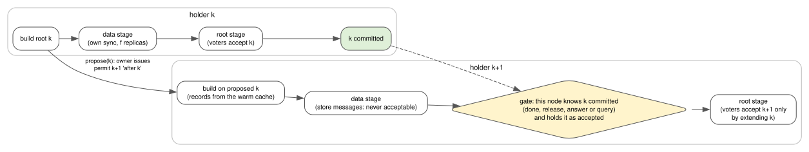

Pipelined permits
=================

*Task 8.3k. Decision D55; rulings R79, R86, R91, R93, R94 and R95; principles P5, P6 and P7. Figures: D55,
5 runs interleaved with the base* ``9e5fe4d`` *on ZFS, medians with [min-max].*

What it gives the ERP
---------------------

At the end of the month every sales person closes deals at once, on all three ERP servers. Each server
already groups the commits of its own threads into one round (D50). The question is how many rounds per second
the *cluster* can complete, because every round on every server must take its turn.

Pipelining lets the next server build its round while the previous one is still making its round durable.
On the benchmark that stands in for the month-end rush (3 peers x 4 threads, 100-byte commits), the cluster
went from a median of 208 to 286 commits per second, with no change in what an acknowledgement means. The
medians hide a spread: the slowest of the five pipelined runs, 141.6 commits/s, was below the base's median.

The problem
-----------

Under D50 the permission chain was **serial**: the owner of the term issued permission *k+1* only after holder
*k* reported ``done``. So every round's build, its own sync, its data replicas' syncs and the voters'
acceptance lay on one cluster-wide chain, back to back.

**Measured symptom** (D55, base ``9e5fe4d``, 3 peers x 4 threads, 100 B, GIL off): **208.3 commits/s**
[187.3-219.7], of which the **permission wait was 33.4 ms per commit**. The budget of Task 8.3h had already
shown the build (about 8 ms per round) and the durability stage (7-10 ms) running back to back.

Why the obvious solution fails
------------------------------

The obvious idea is the one databases call **early lock release** (DeWitt et al., 1984; Aether, Johnson et
al., 2010): let the next holder start as soon as the previous one has built its root, and let it build on that
root before it is committed. The difficulty is not the overlap; it is what the *voters* may accept, and
when.

**The first draft** let holder *k+1* tell the voters that its predecessor had committed (a flag,
``pred_committed``), computed by a local *gate* on the holder. The design review rejected it (finding I1,
ruling R93): it made every holder's gate code trusted for safety, so a bug in a holder could lose durability,
and it was unnecessary, because **the voters already hold the evidence**. A voter that learnt ``done(k)`` has
root *k* as its accepted root, so it can check the new root against its own state, as a Raft follower checks
``prevLogIndex`` against its own log instead of trusting the leader's claim.

**The implementation then found a second gap**, which the implementer stopped to report before going on. The voters'
acceptance rule had two exemptions, for a voter with no accepted root and for a root of a newer term, and they
were checked *before* the chain rule. When *k* was the first root of a term (the common case: the first
permission of every term proposes), root *k+1* was accepted on the strength of the exemption alone, and safety
would again have rested on the holder's gate. The fix is rule V2' below.

The review also found that the outcome classification, as first written ("a conflict before the root stage, an
unknown outcome after it"), did not match the code: a commit could be reported as a retryable conflict after
an acceptable message had already left the node, and then be applied twice (finding I2). Hence rule H7.

The alternatives and their costs
--------------------------------

Most alternatives were rejected by argument; their costs were estimated in the task's design, not measured:

* **depth 2** (three permissions outstanding): deferred. At 3 members every node would be in the pipeline at
  once, a failure would cancel two successors, and the first-order gain is already taken at depth 1;
* **voters that buffer out-of-order roots** (Viewstamped Replication style): rejected; new voter state, and the
  successors' failures become unknown outcomes;
* **no gate at all** (Raft's own pipeline): safe under V2', but successors that overtake their predecessor's
  root stage draw refusals and unknown outcomes, and could not report a commit earlier anyway. The gate is kept
  for the *quality of outcomes*, not for safety;
* **node-local pipelining**: no gain at 3 x 4, where every thread of a node is already in the round;
* **a** ``store_only`` **flag on the replicate message**: rejected for a separate message kind that no code
  path can accept. Non-acceptability by construction beats correctness by a flag the holder must remember to
  set.

The choice, and the invariant that makes it correct
---------------------------------------------------

         the gate before sending its own root.

   Depth 1: holder *k+1* overlaps its build and data stage with *k*'s durability stage. Its root stage waits
   for the gate. Source: ``diagrams/pipeline.dot``.

1. A holder whose round had no conflict sends ``propose(k, root_k)`` to the owner and runs no further round
   under that permission.
2. The owner may issue permission *k+1* on that proposal (``after = k``). Such a permit is never *certain*,
   and the owner sequences the pipeline by rules O1-O8: anything it cannot sequence abandons the term.
3. Holder *k+1* builds on root *k* (its records arrive ahead, through ``warm`` and ``store`` messages) and runs
   its data stage at once, as ``store`` messages, which **no code path can accept** (rule V1).
4. **The gate:** holder *k+1* logs its own acceptance and sends its root to the voters only once this node
   itself knows root *k* committed *and* holds it as its accepted root.
5. If the gate never opens, nothing acceptable ever left the holder, and its commits get a **retryable**
   ``ProtoConflictError``. Any other failure is an **unknown outcome** (rule H7; see :doc:`unknown-outcomes`).

**Within a term, the invariant is enforced by the voters (V2', Raft's log matching applied to roots):** a
voter accepts a same-term root only if it is the voter's accepted root (a duplicate) or *extends* it. So a voter
accepts *k+1* only if it accepted *k*, or learnt *k* committed. Within a term, no holder-side rule is
load-bearing for safety: the gate costs liveness or an honest unknown if it is wrong, never an acknowledged
commit.

**The first root of a term is different, and the voter cannot check it.** The exemptions apply only to a root
whose ``pred`` carries an older label (the check ``first_of_term`` in ``proto_db/cluster/coordinator.py``), and
such a root is accepted under the ballot rule alone. Whether its *base* is at least the value Paxos phase 1
reported is a property of the holder's choice of base (``_lease_base``), not something the message lets the
voter see. That holder-side rule *is* load-bearing for safety, and it is the one finding C1 found broken: in the
schedule of :doc:`unknown-outcomes`, the last step is a first root of a newer term, built on a base below the
phase-1 value and accepted through this very exemption. (See the :doc:`glossary` for the terms.)

.. TODO(C1-fix): once the R127 fix is merged, state that the holder floors the first base of a term at the
   phase-1 value, name the commit and the regression test, and restate "load-bearing" accordingly.

Its cost, stated honestly
-------------------------

Measured (D55, interleaved with ``9e5fe4d``):

==========================================  ==========================  ==========================
Workload                                    GIL off                     GIL on
==========================================  ==========================  ==========================
3 peers x 4 threads, 100 B                  208.3 to 286.3 (+37 %)      191.3 to 219.0 (+14 %)
5 peers x 4 threads, 100 B                  147.9 to 218.5 (+48 %)      154.6 to 201.6 (+30 %)
3 peers x 4 threads, 50 rows per commit     26.4 to 27.6 (+5 %)         24.3 to 24.8
==========================================  ==========================  ==========================

* **With the GIL on, the gate was open at send in only 1 % of pipelined rounds** (79 % with it off): a node's
  acceptor lane, which learns ``done(k)``, competes with its committing thread, so most rounds add a root-only
  sync after the gate.
* **Large commits gain little.** At 50 rows the build per round rose from 118 to 130 ms, the data replica from
  20.5 to 32.5 ms (its syncs now overlap other nodes' work on the same disk), and 20 % of permits were not
  pipelined.
* **Overlap is not free on a shared machine**: the build per round rose 8.3 to 10.0 ms at 3 x 4, because three
  builders share six cores.
* **V2' is stricter, and strictness costs liveness on bad links**: a voter that missed root *k* refuses *k+1*
  once and catches up (D55, "Cost"). The tests check progress at 20 % message loss; the throughput lost there
  was measured during the task but is not recorded in the repository, so it is not quoted.

A mistake that taught a rule about evidence
-------------------------------------------

One of five GIL-on runs at 50 rows failed the benchmark's exact check of commit ids: a node's threads stopped
after an exception, with two replication failures, one gate closure and one extra abandoned term. **The run's
files had not been kept**, so a *missing* id (a lost acknowledged commit, unacceptable) could not be told apart
from an *extra* one (an unknown outcome that took effect, which P5 allows). Fifty-one reruns of the same
shapes with the GIL on (27 and 24) passed (D55).

The review then reproduced the *extra* case (acknowledgements arriving after the permission's validity: an
unknown outcome that took effect) and excluded the *missing* case by argument from the owner and voter rules;
the original run stays unexplained by direct evidence. Two things changed: the benchmark now reports missing,
extra and duplicated ids separately, and it keeps the directories of failed runs. **A failure whose evidence
was deleted can be argued about but never closed.**

What was tried and rejected
---------------------------

* The trusted ``pred_committed`` flag (the first draft), and the exemptions-before-chain order (above).
* Depth 2, VR-style buffering, no gate, node-local pipelining, and the ``store_only`` flag (above).
* Per-permission ballots: rejected earlier (ruling R79, D50); a term has one owner and one ballot.

Back to the ERP
---------------

At month end the three ERP servers no longer wait for each other's syncs in single file: the next server builds
while the previous one makes its round durable, and the cluster completes about a third more commits per second
on the benchmark that stands for the rush. Nothing about an acknowledgement changed. A sales person whose
commit is acknowledged has it on a majority of the voters, and within a term a voter accepted it only on top of
a root it held itself. That it then stays in the history is the design's goal, and the guarantee depends on
how the next term chooses its base: finding C1 (:doc:`unknown-outcomes`) showed that the code at this commit
can break it in one schedule, and the fix is in progress. A sales person whose commit could not be sequenced
gets either a retryable conflict, when nothing acceptable had left the server, or an honest "unknown", which
the next chapter explains.

.. TODO(C1-fix): when the fix is merged, say that an acknowledged commit stays in the history, with the commit.
