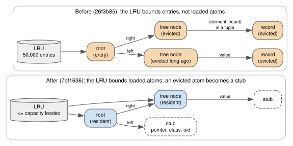
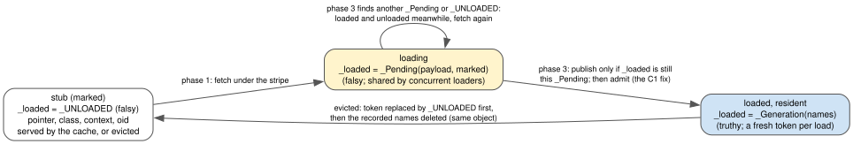

Residency: bounding what a process keeps decoded
================================================

*Task 8.3m. Decision D53 (amendments of Tasks 8.3l and 8.3m); rulings R92, R102 to R105; principles P1, P6
and P7.*

What it gives the ERP
---------------------

The ERP of the tutorial has a thousand opportunities. A real one grows for years: every edit of an
opportunity is a new version, every version stays readable, and the sales team keeps running reports, paging
through results and asking what the pipeline looked like last quarter. The question an operator asks is
blunt:

   *Can the ERP server run for a year on a fixed memory budget, while every report, every page and every "as
   of" question keeps returning correct results?*

For the objects the database decodes, residency makes the answer yes, and the budget is one number the
operator sets from a measured signal. Before it, the answer was no: the server's memory grew with the
database, whatever the cache was told. (One growth remains outside this chapter, and it is stated as an open
item: a node of a tiered cluster keeps a few hundred bytes of metadata per storage segment it has seen; see
:doc:`history-links`.)

The problem
-----------

ProtoDB loads objects lazily. A reference to an object that has not been read is a **stub**: an object that
knows the record's pointer, its class and its identity, and nothing else. Reading an attribute of a stub loads
it **in place**: the stub object itself receives the decoded state, so every holder of the stub now holds the
loaded object. That is cheap and it preserves identity, and it has a consequence that took several tasks to
see in full: **a loaded object holds its children as Python objects, the children load in place too, and so a
loaded object keeps its whole loaded subtree alive.**

The decoded-atom cache (D53, see :doc:`immutability`) kept at most ``atom_cache_entries`` entries, 50,000 by
default. Evicting an entry removed it from the cache's LRU. It freed nothing that a remaining entry still
reached, and the newest roots are always cached.

**Measured symptom** (Task 8.3m design, step 1, ``ladder.py`` on a ``git archive`` of ``26f3b85``, GIL off,
single runs): building a telecom-style inventory of **958,665 objects** with the default 50,000-entry cache
ended with **2,755,611 loaded atoms** alive and a **peak RSS of 2.76 GB**. At 480,815 objects it was 1,385,630
loaded atoms and 1.43 GB. The cache had exactly 50,000 entries throughout. A later rerun of the same base at
the same size, kept in the repository, measured 2,756,907 loaded atoms and a peak of 2.61 GB
(``benchmarks/results/2026-11-06-1845993-residency-ladder.log``). Extrapolated to 10^7 objects, about 28 GB.

The entry count bounded nothing.

         Bottom, an LRU of resident atoms whose evicted children are stubs.

   Top: an entry pins every loaded atom it reaches, evicted or not. Bottom: residency bounds loaded atoms;
   what is evicted goes back to being a stub. Source: ``diagrams/residency-pinning.dot``.

Where the edges are
~~~~~~~~~~~~~~~~~~~

Before choosing a mechanism, the design counted the edges that pin memory (Task 8.3m design, ``census.py``:
the inventory at 20 sites, 68,841 objects, default cache, a breadth-first walk from the cache entries through
loaded atoms only):

* every one of the **199,335** loaded atoms alive was reachable from the cache, and 149,336 of them were not
  cache entries; the walk was 21 levels deep;
* of **386,000** parent-to-loaded-child edges, **120,000 (31 %) were atoms nested inside tuples**: index
  members held as ``(element, count)``, member keys that embed the element's exact token, and key groups.
  An index pinned each element twice;
* an application can nest atoms as deep as it likes inside ``FrozenList`` and ``FrozenDict`` values.

Why the obvious solution fails
------------------------------

**"Evict harder, or use a smaller cache."** Eviction only removes the cache's own reference. The evicted atom
is still loaded, and still referenced by its loaded parent. A smaller cache changes the number of entries,
not the number of loaded atoms they reach.

**"Make the edges weak, or make them pointers."** This is the natural next idea, and it was the fix that had
already worked once: Task 8.3l had made the two *history* links (``previous`` and ``cluster_previous``) hold
only a pointer, re-resolved on every read (:doc:`history-links`). Applied to every edge, it fails twice:

* **it is incomplete.** 31 % of the edges are atoms nested inside tuples, and frozen containers are values
  the application sees. An edge rule must reach inside them, which changes the value model;
* **it puts a cost on every edge a traversal crosses**, and a point read in a 100,000-entry ``Dictionary``
  crosses about 16.7 edges.

The alternatives and their costs
--------------------------------

The design measured each family (Task 8.3m design, section 2.1, ``micro.py`` and ``pointread.py``, GIL off;
GIL on gave the same order):

.. list-table::
   :header-rows: 1
   :widths: 30 45 25

   * - Mechanism
     - Cost per edge crossed
     - Bound
   * - (a) every edge a pointer, resolved through the cache
     - 745 ns against 49 ns for a plain attribute (2,175 ns with 8 threads, one cache lock): a warm point
       read about +12 us, 3.2x
     - partial: direct edges only
   * - (b) weak references to children
     - 337 ns (458 with 8 threads): about +5 us per point read, +90 %
     - partial; weak references need care under free threading
   * - (c) cache only childless decodes
     - every step a lookup and a decode: D53's rejected payload-only cache
     - complete, slow
   * - **(d) residency: evict = unload**
     - **0**: an edge is a plain attribute read; reading an evicted atom costs one decode (28 us with the GIL
       off, 44 us with it on)
     - **complete**

(a) and (b) are incomplete and cost on every edge; (c) had already been rejected. (d) moves the rule from the
*edge* to the *target*: whatever points at an atom, the atom itself goes back to being a stub.

The choice: residency
---------------------

**The bound is on loaded atoms, and an evicted atom is unloaded in place** (D53, Task 8.3m amendment; commits
``7ef1636``, ``700d48f``, ``1845993``):

1. ``_AtomCache`` keeps an LRU of the *loaded* atoms it produced, keyed by pointer, at most
   ``atom_cache_entries``. A stub is not an entry.
2. An atom becomes resident when it is loaded (the load calls the cache's admission hook after it publishes)
   or when the cache receives it decoded on save.
3. An atom the LRU evicts is **unloaded**: its decoded attributes are deleted; its pointer, class, context and
   identity stay. It is a stub again, *the same Python object*, so every holder keeps a valid reference.
4. The next read through any holder loads it again through the ordinary lazy-load path, and is admitted
   again.
5. An **identity map** (pointer to weak reference) returns the one object served for a pointer while anything
   holds it, so a parent's child and a fresh load are the same object and cannot evict each other in turn.

This is not a new kind of reference. It is the existing stub, and "not read recently" now leads back to it
(P7: the simplest correct mechanism).

The invariant that makes it correct
~~~~~~~~~~~~~~~~~~~~~~~~~~~~~~~~~~~

**A pointer's content never changes (P1).** Every load of an atom produces equal values, so any interleaving
of an old state and a reloaded state reads equal values, even a reader that sees attributes from two
generations. Correctness then reduces to excluding exactly two failures (ruling R104):

1. **a missing attribute that is not routed to a load.** A reader can miss a name because an unload deleted
   it after the reader checked that the atom was loaded. Every load therefore sets ``_loaded`` *last*, to a
   fresh *generation token*, and every reader that misses a name concludes "absent" only if the token it saw
   is still current; otherwise it reads again;
2. **a publish into the wrong generation.** This one was found by the design review, and it is the mistake
   told below.

   The states of a shared atom. All of them live in the *value* of one attribute, ``_loaded``, so the object's
   set of keys never changes for bookkeeping. Source: ``diagrams/atom-lifecycle.dot``.

The bound, restated: loaded shared atoms are at most the capacity plus one load in flight per thread. The
proof is a test, not an argument: ``tests/unit/test_atom_residency.py`` walks the graph from every entry and
asserts that no loaded shared atom is reachable without being resident.

In place, not by replacing ``__dict__``
~~~~~~~~~~~~~~~~~~~~~~~~~~~~~~~~~~~~~~~

The first design unloaded an atom by **replacing its** ``__dict__`` with a fresh stub dictionary, so that a
reader holding the old dictionary would still see a complete state. The design review measured what that costs
on CPython 3.14 (design review, finding I1, ``spec_cost.py``, ``inplace_cost.py``):

* objects created normally keep their attributes as *inline values*, and attribute reads specialize to
  ``LOAD_ATTR_INSTANCE_VALUE``: 12.6-13.8 ns per read;
* after a ``__dict__`` assignment, the object is dictionary-backed for good: 19.4-22.0 ns. A read site that
  sees a mix of both kinds de-specializes for all of them;
* unloading *in place* (clear the flag first, delete the keys, set them again on reload) keeps the fast form:
  13.7-14.4 ns.

On a warm ``get_at`` in a 50,000-entry ``Dictionary`` with nothing evicted afterwards, atoms that had once been
unloaded by replacement cost 6.24-6.78 us per read against 4.89-5.06 us for the base. Residency adopted the
in-place form; D53 records the decision as 12.6 against 21.1 ns per attribute read.

Two more CPython facts surfaced while measuring the implementation (Task 8.3m report, fixed in ``700d48f``).
Adding a key that a class's instances did not have when they were created materializes the instance
dictionary; and once an object's dictionary has been materialized (one ``obj.__dict__`` or ``vars(obj)``
suffices) the specializer never again picks the fast form for it: **43 against 9 ns per read**. The first
implementation did both, and query paths were 15-35 % slower than the base with nothing evicted. The fix keeps
every piece of bookkeeping in the *value* of ``_loaded`` and never reads an atom's ``__dict__`` on the
residency paths. Both facts are pinned by tests (``test_cache_atoms_keep_the_inline_values_layout``,
``test_the_residency_paths_never_materialize_the_instance_dict``).

The mistake: the C1 race
------------------------

The design argued: "the unload and the publish of a load are serialized on the atom's lock (its *stripe*), and
an atom is admitted only after it is loaded, so the cache never unloads an atom that is half loaded". The
adversarial design review found the interleaving that argument missed, and reproduced it deterministically in
both GIL modes (``task-8.3m-design-review.md``, finding C1, ``race_republish2.py``).

A load has three phases (since D21): phase 1 fetches the record under the stripe; phase 2 decodes it *with no
lock held*, because decoding is slow; phase 3 publishes under the stripe. The argument covered phase 3 against
an unload. It did not cover a load whose phase 1 ran **before** an unload and whose phase 3 ran **after** it:

====  ===================================================  ===================================================
Step  Thread A                                             Thread B
====  ===================================================  ===================================================
1     starts loading stub S                                starts loading stub S
2                                                          finds the fetched payload; decoding (no lock)
3     publishes S; S is admitted
4     *evicted: S's dict replaced by a stub dict*
5                                                          phase 3: S looks unloaded, so B publishes into the
                                                           *new* stub, then fails to remove a payload key
                                                           that the new stub never had
====  ===================================================  ===================================================

What the reviewer observed: thread B raised ``AttributeError`` about an attribute no caller had named, and S
ended **loaded but not resident**. Both consequences are serious:

* **silent wrong values.** The ``AttributeError`` escapes through ``__getattr__`` as "attribute absent", so
  ``getattr(obj, name, default)`` and ``hasattr`` return the default, or ``False``, for an attribute that
  exists;
* **an escape from the bound, for good.** Nothing admits S again, because admission happens only when a stub
  loads. S and its loaded subtree stay pinned for as long as anything holds S, and it happens again on every
  such race. The million-object bound test would not have seen it: single-threaded builds never interleave a
  decode with an eviction.

The window is one decode (28-44 us). At the default capacity it needs an unlucky pause, such as a garbage
collection, between two loads; under a small capacity and eight threads it is frequent. Under P7, rare is not
acceptable.

**The fix.** Phase 1 stores the fetched payload in ``_loaded`` itself, as a falsy ``_Pending`` object that
concurrent loaders share. Phase 3 publishes only if ``_loaded`` is *still that very* ``_Pending``
(``_same_generation`` in ``proto_db/core/atom.py``); otherwise the atom was loaded and unloaded meanwhile, and
the load starts again. Every publish then goes through admission. A deterministic test pauses the decode of a
second loader, forces an eviction meanwhile, and checks that the stale loader restarts and is admitted
(``test_a_load_racing_an_unload_never_publishes_into_the_newer_stub``); a planted variant that publishes into
any generation and skips admission leaves a loaded atom outside the bound and fails
(``test_planted_unadmitted_publish_escapes_the_bound``).

**The lesson.** A check-then-act protocol is only as safe as its *longest* gap. The design reasoned about the
two phases that held the lock and forgot the phase between them that did not.

A second, smaller mistake is worth knowing. A subclass may override ``Atom._restore``, the hook that installs
a decoded state. Residency unloads exactly the keys a load installed, so an override that renamed, dropped or
added keys broke it: a renaming override made every load recurse (``RecursionError``), and a decoded twin's
``_state()`` spun forever (Task 8.3m review, finding I1, reproduced). The contract is now checked on a scratch
instance and a violation raises one ``ProtoUserError`` naming the class, the hook and the keys.

Its cost, stated honestly
-------------------------

**Memory, the reason for the change** (``benchmarks/results/2026-11-06-1845993-residency-ladder.log``, base
``26f3b85`` against ``1845993``, default capacity, GIL off, single runs):

===========================  ===================  =================  ==================================
Inventory                    Peak RSS             Loaded atoms       Warm port lookup / path trace
===========================  ===================  =================  ==================================
958,665 objects, base        2.61 GB              2,756,907          78.3 us / 0.87 ms
958,665 objects, residency   **0.26 GB**          **50,000**         926.6 us / 29.3 ms
2,972,442, residency         0.26 GB              50,000             1,132.2 us / 36.7 ms
9,626,985, residency         **0.27 GB**          50,000             1,398.4 us / 47.2 ms
958,665 objects, capacity    4.09 GB              2,790,616          74.9 us / 0.78 ms
3,000,000 (the set fits)
===========================  ===================  =================  ==================================

The 10^7 step did not fit in 20 GB before (D53); it now peaks at 0.27 GB. The table also shows the price.

* **Reads whose working set does not fit reload, and the loss is a cliff.** At the default capacity, the
  inventory's warm port lookup went from 78 us to 0.93 ms and a path trace from 0.87 ms to 29.3 ms: the
  database is 50 times larger than the cache, and random reads over it reload almost everything. In a
  20,000-record probe whose working set is just 20 % over the capacity (``benchmarks/residency_probe.py``, log
  ``benchmarks/results/2026-11-06-8.3m-residency-probe.log``, at ``236a228``, median of 3 runs), a lookup took
  **201 us against 4.6 us** when the set fits (GIL on: 209 against 4.9 us). A cyclic pattern larger than the
  cache evicts, on every pass, exactly what the next pass needs.
* **Bookkeeping.** A resident atom costs about 0.4 KB more than a loaded atom did before (identity map, LRU
  entry, generation token): 4.09 GB against 2.61 GB peak for about the same 2.8 M loaded atoms (table above).
* **Cold requests** (a new space per request) are about 10 % slower even when everything fits: each load is
  admitted and registered (admission alone about 4.5 us per load; Task 8.3m report).
* **Cluster commits.** The 3-peer x 4-thread, 100 B headline ran 9-11 % slower with the GIL off (199 against
  219-224 commits/s, two sessions of 5 paired runs) and 3-13 % with it on; every saved atom's decoded twin now
  gets an identity-map entry, a token and an admission (D53, Task 8.3m report).
* **A closed space.** ``ObjectSpace.close()`` clears the cache. An object the application still holds keeps
  what is loaded; reading what is not raises ``ProtoClosedError``, never a silent default. Objects outlive their
  space only as values already materialized.

**Sizing, with a measured signal.** ``atom_cache_stats()`` reports ``loads`` and ``read_unloads`` (the
unloads that loads caused). Between two snapshots, ``read_unloads / loads`` is about 0 when the working set
fits and approaches 1 when it does not; the probe above gives 0.00 and 1.00. The :doc:`CAD tutorial
</tutorials/cad>` shows the signal on running code. Its first version divided the *total* unloads by the
loads (``cbed5fd``); but commits also evict, because every saved twin is admitted, so over an interval with
commits that ratio exceeded 1 without a single wasted reload (about 1,150 over the build of the 10^6
inventory). The signal now counts what reads evicted, and nothing else.

What was tried and rejected
---------------------------

* **Edge rules (a) and (b):** incomplete for nested atoms, and a cost on every edge.
* **Replacing** ``__dict__`` **to unload:** 1.4-1.6x per attribute read afterwards, measured.
* **A CLOCK second-chance bit.** Recency by admission order means a hot node reached only through attributes
  is evicted after ``capacity`` admissions, and the obvious remedy is a "referenced" bit that every read sets,
  sparing such nodes once. It was implemented, with the bit kept inside the generation token so that the
  layout did not change, and measured (Task 8.3m report, fix rounds 1 and 2; D53 "Sizing"):

  * with a capacity that fits, it **cost** on point reads: ``point_lookup`` ``get_at`` at 0.73x the speed of
    admission order with the GIL off (0.93x with it on; below 1 in all six runs), the per-edge write the design
    had predicted (about 60 ns on each of the ~17 nodes a lookup passes, inferred, not profiled);
  * over the capacity it **helped, but not enough**: in the probe, 201 to 144 us per lookup, still about 30
    times the 4.6 us of a fitting cache.

  The reason is general, and worth remembering: **no recency policy survives a cyclic access pattern larger
  than the cache.** Each pass evicts what the next pass needs, whatever the policy guesses. The bit is a write
  on every read to soften a case that only a larger cache cures.
* **A larger default capacity.** It only moves the cliff, and its price is memory: about 1.5 KB per resident
  atom in all on the inventory. The default stays 50,000 loaded atoms (ruling R103-2), and
  ``atom_cache_entries`` is sized per application from the signal above.
* **A byte bound** (an estimated size per atom): parked, not rejected (ruling R103-2).

Back to the ERP
---------------

The memory the ERP server spends on decoded objects is now set by one number, ``atom_cache_entries``, not by
the size of the database or the length of its history. Every object a report or a pager holds stays valid: if it is evicted, it is a stub
again, and the next read loads the same content, because the content at a pointer never changes. An "as of"
question about last quarter loads what it reads and lets it go. The operator's part is to watch
``read_unloads / loads`` on the real workload and raise the capacity until it is near zero, knowing the price:
a cache too small for the daily reports turns them into disk reads, never into wrong answers.
