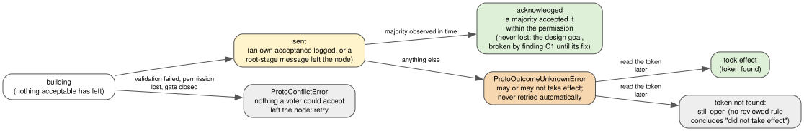

Unknown outcomes
================

*Ruling R86; decisions D34, D46, D50 and D55 (rule H7); principle P5. The mistake told at the end is finding C1
of the Task 8.3n round 3 re-review.*

What it gives the ERP
---------------------

Ann marks opportunity 3 as won. Her server sends the new root to the voters, and then its network stalls. The
commit returns ``ProtoOutcomeUnknownError``: *the commit may or may not take effect.*

That sounds like a weakness. It is the most honest answer a distributed system can give, and the ERP can
settle it, but only with one addition the tutorial does not have yet: each change must write a unique request
id into the new version of the opportunity. The application then reads the opportunity once the cluster
answers again and looks for the id, as :doc:`/durability` prescribes for every storage. Found: the change took
effect. Not found: the ERP keeps the outcome open and reads again later; when it may conclude "did not take
effect" is the subject of the parked rule discussed below, which has not been reviewed. What
the application must *not* do is retry blindly: if the first attempt took effect, the retry writes a second
"won" version, and the audit trail of opportunity 3 shows the deal won twice.

The problem
-----------

A cluster commit is decided by the voters, not by the committing node: it is committed once a majority has
durably accepted its root (D46). After the root has left the node, many things can stop the node from learning
the result: a lost acknowledgement, a slow thread that observes the majority only after its lease ended, a
crash of the node, a partition. The voters may have accepted the root, may yet accept it, or may never.

**Measured symptom** (D50 amendment, ruling R86): a clean full run at ``3c6e870`` with the GIL off failed two
cluster tests. One raised ``ProtoOutcomeUnknownError`` (every acknowledgement counted after the lease had
ended). Under 8 CPU hogs, 15 iterations of both tests failed in 6 iterations at ``b4259ce`` (13 unknown outcomes
in the contention test) and in 5 at ``3c6e870`` (14); idle, 40 iterations of each of three commits had no
failure. **Every failure reported "may or may not take effect", and no acknowledged commit was missing.** The
tests failed because they counted commits exactly.

Why the obvious solutions fail
------------------------------

* **Report a failure.** The root may already be accepted by a majority, or a root accepted only by a minority
  may be adopted later by another member's recovery round (the R123 mechanism). A "failed" commit would then
  appear in the database: the report would be a lie, and a caller that retried would apply it twice.
* **Retry automatically.** The same double application, done by the library.
* **Wait until the outcome is known.** Under arbitrary delay and partition (P5) the wait has no bound, and
  a decision taken when a timer expires is a decision taken by timing, which P5 forbids for safety.
* **Make the tests count exactly.** That bends the failure model to fit the tests, the opposite of P7.

The alternatives and their costs
--------------------------------

* **Resolve the outcome inside the library, by querying the voters with the root's pointer** (ruling R96,
  parked): the pointer is a unique commit id; walk ``previous`` from the committed root; found means success,
  a successor of the base without it means a safe retry, still at the base means undecided. Not built and not
  reviewed; it is a liveness improvement, the undecided case remains, and its "safe retry" conclusion has not
  been reviewed (see "What was tried and rejected").
* **Resolve late-observed acknowledgements with a commit query** (D50 open item): a majority observed after the
  lease ended could be confirmed instead of reported unknown. Not scheduled; liveness only.
* **Resolve by reading an application token** (adopted for the tests in ``385cd04`` and ``47aa05e``): every
  commit writes a unique token, and an unknown outcome is settled by reading for it later. It costs one value per
  commit and one read per unknown outcome.

The choice, and the invariant that makes it correct
---------------------------------------------------

**An outcome is reported only as what can be proven** (D46, D55 rule H7):

         unknown outcome is settled as "took effect" when a later read finds its token, and otherwise stays
         open.

   The outcomes of a cluster commit. Source: ``diagrams/unknown-outcome.dot``.

* **acknowledged**: a majority accepted the root within the permission. It is never lost: finding C1,
  below, was a schedule (a slow clock and a delayed message) that lost an acknowledged commit, and
  ``276a256`` fixed it;
* ``ProtoConflictError``: **nothing that could be accepted left the node** (no own acceptance logged, no
  root-stage message sent, every data-stage message a non-acceptable ``store``). Retrying is safe, and
  ``Database.run`` does it;
* ``ProtoOutcomeUnknownError``: **everything else.** ``Database.run`` never retries it.

The invariant is the truthfulness of the two definite answers: a conflict report implies the commit cannot take
effect, so a retry never doubles it; an acknowledgement implies a majority holds the root. Unknown is the
complement, and it is allowed to be large, because it is honest. (That a majority holding the root keeps it in
the history is a separate property, the one finding C1 broke and ``276a256`` restored.)

The tests follow the same rule (ruling R86): they assert **safety bounds**, never exact counts. Every
acknowledged id is present exactly once; every other id present ended in an unknown outcome
(``acked <= persisted <= acked + unknown``); no id appears twice; and each peer acknowledged at least one
commit (progress).

Its cost, stated honestly
-------------------------

* **The application must handle a third outcome.** The pattern is a token written with the commit and a read
  to settle it; :doc:`/durability` states it for every storage.
* **Unknown outcomes are more frequent under load.** They are conservative, P5-allowed results, and they become
  frequent when threads are starved of CPU (the measured symptom above). Extreme synthetic load is therefore a
  separate, periodic stress task that asserts only safety and counts liveness failures (ruling R125).
* **The tests became weaker in one respect**: a lost count could in principle hide behind an unknown outcome.
  The mitigation is that every extra id must be traced to an unknown outcome, and a loss below the acknowledged
  count still fails.

The mistake: a recovery round that ended too early
--------------------------------------------------

Unknown outcomes interact with the cluster's recovery. When a new lease is not *certain* of its base (an
earlier term's outcome is unknown to its granters), the holder asks a majority for the roots they hold and takes
the highest as its base: a **recovery round**. Task 8.3n round 3 changed that round to end as soon as a majority
of witnesses had answered, instead of waiting for every voter (``1b3a188``), to stop recoveries from taking a
full ``request_timeout`` when one voter was dead. Its justification, in the code and in D46, was the classic
majority argument:

   *every committed root was accepted by a majority, which intersects the answering majority, so the result is
   the newest committed root or one built on it.*

The adversarial re-review showed that the argument does not hold, and reproduced an **acknowledged commit being
lost** (finding C1, Critical, at ``9129d52``). The reviewer reproduced it deterministically with five voters,
in a test outside the repository that forces the schedule below. That reproduction is now committed as a
regression test, ``tests/unit/test_cluster_recovery_base.py``, described under the fix below.

**Why the intersection argument fails.** Intersection proves that a member of the answering majority accepted
every root committed *before it answered*. It says nothing about roots accepted *after* it answered, unless the
answer was a promise. The recovery query carries ballot 0: it promises nothing, so a member that has answered
may still accept a root of an older term afterwards. In Paxos, that is exactly what phase 1 is for: the
promise is what makes an answer stay true. And the phase-1 information *was* there: the lease's granters had
promised the new term and reported their accepted roots (``lease.root``). The base taken from the recovery round
was never floored at that phase-1 value, so it could order below it.

**The schedule** (voters a to e; one slow timer and one delayed message, both inside the failure model):

1. e owns term T' (4100), granted by b and c. e's lease reads a clock that runs slow (a slow timer, or a
   suspended machine).
2. e replicates root R'. It reaches b; its copy for c is held back by the network.
3. Real time passes the granters' promises to e. a owns term T (8192), granted by b and d.
4. Phase 1 reports R' to a: ``lease.root`` is R', and the lease is not certain.
5. a's recovery round is answered by c and d, a majority with a, so it ends at once and returns an older root,
   r1 (4096).
6. e's delayed message reaches c, and c accepts R'. e counts the acknowledgements of b, c and itself (3 of 5)
   within its lease, *by its own clock*: **R' is acknowledged.**
7. a builds on r1 and commits under T, acknowledged by a, c and d. Every voter accepts the first root of a newer
   term over its accepted root, by the ballot rule alone.

R' was acknowledged and is not in the history.

**Why it had survived.** The only thing in its way was a sentence in D46: the recovery round is sent under the
lease, "i.e. after every earlier lease ended". That is a timing premise: an earlier holder counts
acknowledgements while *its own timer* says its lease is valid, and that timer ending before its granters'
promises end is exactly the rate assumption that the lease margin is documented never to be a safety premise.
The hole predated ``1b3a188`` (it needed a late answer before); the change made it the normal path, and wrote
the false argument down as its justification. The deterministic test of ``1b3a188`` checked only how long the
round took, never what it returned when the omitted voter held the highest root.

**The fix** (ruling R127; ``276a256``, merged in ``359f128``): a lease's base never orders below the phase-1
value. The base of an uncertain lease or permission is the higher, in ``compare_roots`` order, of ``lease.root``
(or ``permission.root``) and the recovery result (``_lease_base``, ``_phase_1_floor``). That is safe because a
member of the granting majority promised the term before it replied, so every root a majority had accepted in a
lower term was reported to the new holder, and the floor needs no clock. The alternative, ending the round only
once every granter has answered, was rejected: it waits ``request_timeout`` whenever a granter dies after
granting, the no-progress loop that ``1b3a188`` removed. D46's argument is restated without "after every earlier
lease ended" (D46 and the C1 amendment in ``docs/decisions.md``). The tests are in
``tests/unit/test_cluster_recovery_base.py``: the reviewer's reproduction through the product's ``_lease_base``,
for a lease and for a permission, and a check that a recovery root above the floor is still adopted. The plant
``c1_no_floor`` fails both floor tests. See :doc:`/coordinator-protocol` for the protocol.

A second fix completes it (``db1a4c8``, merged in ``f6112d8``). A floor root accepted only by members that are
now down cannot be re-committed, and before the fix the term stalled while a majority was alive. The holder now
abandons the term when the records of its base are unreachable (``_BaseUnreachable``, a retryable conflict:
nothing was replicated), and the next owner's phase 1 decides the root. Its test is
``test_i1_a_floor_base_whose_records_are_unreachable_abandons_the_term``, and the plant
``unreachable_base_none`` fails it.

**The lessons.** A majority answer is evidence about the past only if it was a promise about the future. And a
sentence of the form "by then, every earlier lease has ended" is a statement about clocks; under P5 it can
never carry safety (compare the rejoin mistake in :doc:`coordinator`).

What was tried and rejected
---------------------------

* Reporting failures, retrying automatically, waiting for certainty, and exact-count tests (above).
* Resolution by querying voters with the root pointer (R96) and by commit query (D50 open item): parked, not
  rejected, and not reviewed. R96's rule concludes "did not take effect" from a committed root that succeeds
  the base without containing the commit. That conclusion holds only if (1) the root read is known to be
  committed, and (2) no acknowledged or committed root is ever superseded by a root that does not descend from
  it. Condition (2) was exactly what finding C1 broke; since ``276a256`` the code holds it, but the rule as a
whole has still not been reviewed, so it stays parked.

Back to the ERP
---------------

When Ann's click returns "unknown", the ERP does not guess. Once it writes a request id into the new version
of opportunity 3 (the addition this chapter asks of the tutorial), it looks for the id on a later read: found,
the deal is won; not found, it keeps the question open and asks Ann before marking the deal again, because no
rule to conclude "did not take effect" has been reviewed yet. A "conflict" means nothing a voter could accept
left the server, so the ERP, or ``Database.run``, can simply retry. An acknowledgement means the deal is won on
a majority of the voters. That it then stays won, whatever happens to Ann's server afterwards, is the property
that finding C1 broke in one schedule and ``276a256`` (merged in ``359f128``) restored.
